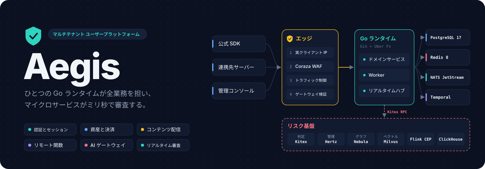
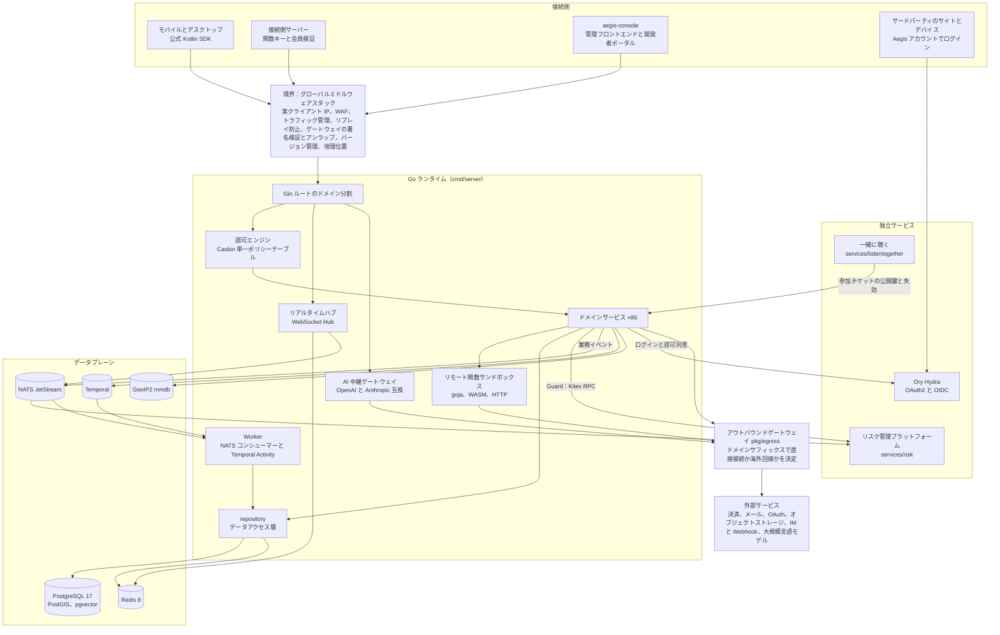
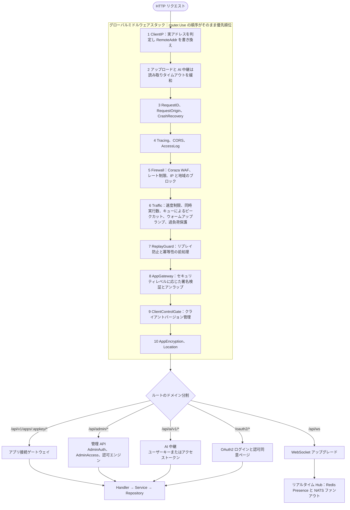
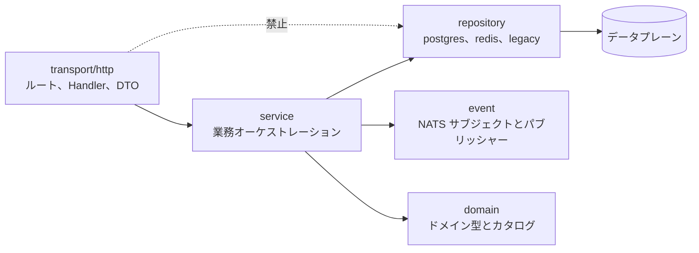
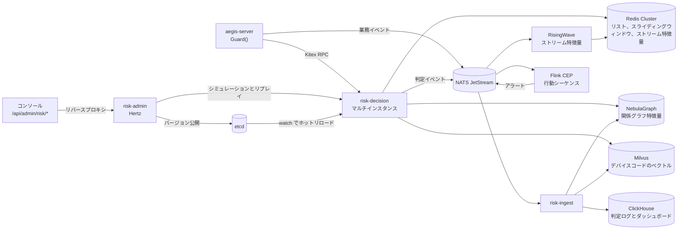

<div align="center">
  
</div>

<div align="center">

**言語：** [English](README.md) | [简体中文](README.zh-CN.md) | **日本語**

[](https://go.dev/)
[](https://gin-gonic.com/)
[](https://www.cloudwego.io/)
[](https://www.postgresql.org/)
[](https://redis.io/)
[](https://nats.io/)
[](https://temporal.io/)
<br/>
[](https://www.nebula-graph.io/)
[](https://milvus.io/)
[](https://clickhouse.com/)
[](https://flink.apache.org/)
[](https://nextjs.org/)
[](LICENSE)
<br/>
[](https://github.com/MiChongs/aegis/actions/workflows/go-ci.yml)
[](https://github.com/MiChongs/aegis/actions/workflows/console-ci.yml)

**Aegis** は本番環境向けのマルチテナント ユーザープラットフォームである。<br/>
1 つの Go ランタイムがすべての業務機能を担い、独立したマイクロサービス群がミリ秒単位のリアルタイムリスク管理を行い、<br/>
1 つの Next.js コンソールがすべての運用と設定を担う。接続側が知る必要のある API 名前空間は 1 つだけである。

<p>
  <a href="#プラットフォーム概要">概要</a> &nbsp;|&nbsp;
  <a href="#アーキテクチャ">アーキテクチャ</a> &nbsp;|&nbsp;
  <a href="#リスク管理プラットフォーム">リスク管理</a> &nbsp;|&nbsp;
  <a href="#アプリ接続プロトコル">接続プロトコル</a> &nbsp;|&nbsp;
  <a href="#機能マップ">機能マップ</a> &nbsp;|&nbsp;
  <a href="#管理コンソール">コンソール</a> &nbsp;|&nbsp;
  <a href="#技術スタック">技術スタック</a> &nbsp;|&nbsp;
  <a href="#クイックスタート">クイックスタート</a> &nbsp;|&nbsp;
  <a href="#ドキュメント索引">ドキュメント</a>
</p>

</div>

---

## プラットフォーム概要

登録とログイン、セッションとデバイス、ポイントとチェックイン、ウォレットと会員、決済と証憑、サポートチケットと通知、リスク管理と監査。
ほぼすべてのプロダクトがこれらを一から書き直している。Aegis はそれらを `appid` で分離されたマルチテナントサービスにまとめた。
接続側が受け取るのは**プロトコルと SDK**、運用側が受け取るのは**コンソール**であり、各自で二次開発が必要なスキャフォールドではない。

<table>
  <tr>
    <td width="33%" valign="top">
      <h4>1 つのランタイム</h4>
      <code>cmd/server</code> は API と Worker を同一プロセスで担う。必要に応じて <code>cmd/api</code> と
      <code>cmd/worker</code> に分割して個別にスケールでき、組み立てと依存性注入（Uber Fx）は完全に共通である。
    </td>
    <td width="33%" valign="top">
      <h4>1 本の分離線</h4>
      <code>appid</code> でアプリの境界を区切る。ユーザー、セッション、キャッシュ、通知、リアルタイム経路、設定と鍵はすべてアプリ単位で分離され、
      アプリをまたぐ読み書きは service 層で明示的に遮断される。
    </td>
    <td width="33%" valign="top">
      <h4>1 つの接続面</h4>
      クライアントに必要なのは <code>/api/v1/apps/{appKey}/*</code> だけ。認証、プロフィール、二要素認証、資産、コンテンツ、サポートチケット、ストレージがすべて含まれ、
      API カタログは <code>/config</code> とともに機械可読な形で配信される。
    </td>
  </tr>
  <tr>
    <td width="33%" valign="top">
      <h4>リスク管理を独立したプラットフォームに</h4>
      判定、関係グラフ、ベクトル、ストリーム特徴量、行動シーケンスは <code>services/risk</code> 配下の独立マイクロサービスが担う。
      メインサービスに残るのはごく薄い <code>Guard</code> 接続層だけで、ルールを変更してもメインサービスの再デプロイは不要である。
    </td>
    <td width="33%" valign="top">
      <h4>カタログ駆動</h4>
      決済チャネル、メールプロバイダー、OAuth チャネル、ストレージドライバー、リモート関数の機能、リスク特徴量はすべてサーバーが<strong>自己記述カタログ</strong>として配信し、
      コンソールのフォームとバリデーションは同じものを共有する。フロントエンドにはハードコードしない。
    </td>
    <td width="33%" valign="top">
      <h4>設定には必ず実行点を</h4>
      DB に保存されるスイッチには、それを実際に読むコードが必ず存在しなければならない。同じ事柄の設定入口は 1 つだけである。
      保存されるだけで読まれない設定は、存在しないより危険である。管理者はすでに防げていると思い込むからだ。
    </td>
  </tr>
</table>

### エンジニアリング概況

| 項目 | 現状 |
| --- | --- |
| メインサービス | Go 1.26、Gin 1.12、pgx/v5、Uber Fx。オプションで TLS を自前で終端し HTTP/3（quic-go）を提供 |
| リスク管理プラットフォーム | CloudWeGo Kitex + Hertz マイクロサービス：`risk-decision`、`risk-admin`、`risk-ingest`、加えて Flink CEP ジョブ |
| 管理フロントエンド | Next.js 16、React 19、Tailwind CSS 4、shadcn/ui、TanStack Query、AntV G6 |
| ルート規模 | ランタイムのルートテーブルは 1600+ 件、うちアプリ接続ゲートウェイが 215 件（`go run ./cmd/server routes` でリアルタイム集計） |
| ドメインサービス | `internal/service/` 配下に 86 のサービス、280+ のソースファイル |
| DB マイグレーション | `migrations/postgres/` を順に実行、`000001` から `000150` まで |
| コンソール | 43 のページルート、公開の開発者ポータルを含む |
| 組み込みチャネル | 決済 16、メール 9、OAuth 13、オブジェクトストレージ 12、CAPTCHA 6 段階 |
| 公式クライアント | `sdk/kotlin`（Android と JVM サーバーで共用）、`mcp/`（AI アシスタント向けの MCP サービス） |

---

## アーキテクチャ

### システム全体像



**外部への出口は 1 つだけ。** OAuth、決済、オブジェクトストレージ、GeoIP 更新、Webhook、メール、大規模言語モデルの上流はすべて `pkg/egress` を経由し、
同じルートテーブルで各ドメインを直接接続にするか海外回線にするかを決める。ゲートウェイを無効にするとすべて直接接続になる。詳細は [docs/egress-gateway.md](docs/egress-gateway.md) を参照。

### 1 つのリクエストが通過するもの



`ClientIP` は必ず先頭に置く。以降のアクセスログ、レート制限、ブロック、WAF、トラフィック管理、地理リスク管理はすべて、これが算出したアドレスの上に成り立つ。
Gin 組み込みの転送ヘッダー解析は明示的に無効化しており（`SetTrustedProxies(nil)`）、判定が 2 系統になるのを避けている。トラフィック管理は Firewall の後、
ReplayGuard の前に置く。まず悪意あるトラフィックを拒否し、次に正当なトラフィックを整形する。拒否されたリクエストは Nonce と冪等キーを消費しない。
詳細は [docs/client-ip.md](docs/client-ip.md) と [docs/traffic-management.md](docs/traffic-management.md) を参照。

### 実行形態

| エントリ | 担う処理 | 用途 |
| --- | --- | --- |
| `cmd/server` | API と Worker を同一プロセスで実行、全運用サブコマンドも含む | デフォルトの形態、単一マシンと中小規模のデプロイ |
| `cmd/api` | HTTP と WebSocket のみ | 接続層を独立してスケールしたいとき |
| `cmd/worker` | NATS コンシューマーと Temporal Worker のみ | バックグラウンドタスクとワークフローを独立して拡張 |
| `services/risk/cmd/*` | `risk-decision`、`risk-admin`、`risk-ingest` | リスク管理プラットフォーム、compose の `risk` profile で起動 |
| `services/listentogether` | 一緒に聴くのルームサービス（WebSocket と Connect RPC） | オンライン音楽再生の複数人同期 |

最初の 3 つのエントリは `internal/bootstrap` の同じ組み立てとライフサイクルを共有し、違いはどのコンポーネントを有効にするかだけである。

### レイヤーと依存方向



リポジトリ全体を貫く 4 つの厳格な制約：

- **Handler は repository に直接アクセスしない**。業務判断はすべて service に下ろす。
- **レスポンスは `pkg/response` に統一する**（`response.OK` と `response.Error`）。生の `c.JSON` は書かない。
- **設定は `internal/config.Config` からのみ取得する**。業務コードは `os.Getenv` を呼ばない。
- **複雑な書き込みには pgx の明示的トランザクションを使う**。ログはすべて zap で構造化出力する。

### データプレーンの役割分担

| コンポーネント | 担う | 担わない |
| --- | --- | --- |
| PostgreSQL 17 + PostGIS + pgvector | すべてのトランザクションデータ、監査、ジオフェンスと分析 | 高頻度のカウントとオンライン状態 |
| Redis 8 | セッションインデックス、キャッシュ、レート制限、オンライン状態、冪等性とリプレイ防止、ランキング、トラフィック管理のクラスタクォータ | トランザクションの信頼できる情報源 |
| NATS JetStream | イベントのファンアウト、インスタンス間のリアルタイム配信、Worker の疎結合化、リスク管理イベントバス | 長いトランザクションのオーケストレーション |
| Temporal | ワークフローのオーケストレーションとリトライのセマンティクス | ミリ秒単位のリクエスト経路 |
| GeoIP2 mmdb | IP の帰属と ASN、自動更新 | 精密な位置特定 |
| レガシー MySQL | 旧 Node.js システムの読み取り専用の移行元 | あらゆるオンライン書き込み |

---

## リスク管理プラットフォーム

リスク管理はメインサービスから切り出され、`services/risk` 配下の独立マイクロサービス群となった。メインサービスに残るのは `RiskService.Guard`
というごく薄い接続層だけである。業務側の呼び出し箇所は変わらず、ルール、特徴量、モデル、決定フローの変更はコンソールで公開すると数秒で反映され、メインサービスの再デプロイは不要である。



| コンポーネント | リスク管理での役割 |
| --- | --- |
| **CloudWeGo Kitex** | 判定 RPC：長期接続の多重化とクライアント側ロードバランシング。ログイン、注文、抽選などのホットパスはすべてここを通る |
| **CloudWeGo Hertz** | `risk-admin` の管理 API。コンソールはメインサービスの署名付きプロキシを経由してアクセスする |
| **etcd** | サービスの登録と検出、設定の公開チャネル（判定インスタンスが watch でホットリロード）、シングルトンタスクのリーダー選出 |
| **Redis Cluster** | リストの完全一致インデックス、リアルタイムのスライディングウィンドウ集計、RisingWave が書き戻すストリーム特徴量、グラフとベクトル特徴量のキャッシュ |
| **RisingWave** | SQL で長いウィンドウの集計特徴量を定義し（例：24 時間の決済金額、7 日間のデバイス数）、Redis Cluster に書き戻す |
| **Flink CEP** | イベントをまたぐ時系列パターン。例：「複数回失敗した後に成功」「登録後の短時間に複数のデバイスに切り替えてログイン」 |
| **NebulaGraph** | ユーザー、デバイス、IP、ネットワークセグメント、電話番号、メールアドレス、招待、サードパーティアカウント、支払いアカウントの関係グラフ。判定はグラフ特徴量を取得し、ユーザー詳細ページは関係ネットワーク全体を描画する |
| **Milvus** | デバイスコードのベクトル：まずデバイスコードの文字で候補を取り出し、次に編集距離でスコアリングして、1〜2 文字しか違わないデバイスを見つける（スクリプトによる一括生成、端末やコードの改ざん） |
| **ClickHouse** | 判定ログ（完全な軌跡を含む）、業務イベント、アラート、処置記録。概要ダッシュボードとユーザーのリスクタイムライン |
| **expr-lang/expr** | ルール条件と派生特徴量の式。一度だけコンパイルし、リフレクションなしで評価する |
| **gorules/zen-go** | 決定フロー（JDM の決定表と決定グラフ）。コンソールでは `@gorules/jdm-editor` でビジュアル編集する |
| **open-policy-agent/opa** | 最終判定のガードレール（Rego）：ホワイトリストによる救済、会員保護、自動ブロックの適用シナリオ範囲 |
| **dmitryikh/leaves** | LightGBM と XGBoost の木モデル推論。純 Go で CGO 不要 |

いくつかの設計上の判断：

- **観察と適用の分離。** 各ルールは個別に観察モードに設定できる。ヒットを記録するだけで結果には影響しない。新しいシナリオはデフォルトで観察モードとして公開し、誤検知を確認してから 1 件ずつ適用に切り替える。
- **関係グラフの完全な初期化。** `risk-admin` は初回起動時にメイン DB の 15 のソース（登録、ログイン、デバイス、サードパーティアカウント、招待、決済……）から関係グラフをバックフィルし、繰り返し実行できる。プロキシと CDN のアドレス、プレースホルダーのデバイスコード、UA のダイジェストはグラフに入らない。IPv6 は /64 の回線単位でノードを作るため、同じ端末がローテーションするプライバシーアドレスが数十の IP として扱われることはない。
- **弱い関係は拡散しない。** データセンターの出口や複数人で共用される出口 IP はグラフ上に通常どおり表示されるが、グラフ特徴量の集計には加わらず、そこからさらに展開することもない。
- **9 つの本人確認とアカウントセキュリティの接続点。** ログイン、登録、抽選、決済などの業務シナリオに加え、サードパーティログインと連携、OAuth2 認可、Passkey ログイン、QR コードログイン、パスワード変更、連絡先の変更、退会、会員トライアルもすべて接続済みで、イベントには識別子のダイジェストのみを含める。

詳細は [docs/risk-platform.md](docs/risk-platform.md) を参照。

---

## アプリ接続プロトコル

接続側が知る必要のある名前空間は `/api/v1/apps/{appKey}/*` の 1 つだけである。ログイン後にクライアントが実際に使う**すべての**機能をカバーする：
認証ライフサイクル、プロフィールと設定、二要素認証と Passkey、セッションと監査、チェックイン、ポイント、ランキング、サイト内メッセージ、ウォレット、会員、決済、
ストレージへのアップロード、サポートチケット、バナー、お知らせ、バージョンチェック。

### 3 段階のセキュリティレベル

3 段階は同じパス群と同じ JSON 構造を共有し、変わるのはリクエストを**どうラップするか**だけである。レベルを上げても transport アダプターを 1 層差し替えるだけで、業務コードは変わらない。

| レベル | クライアントがすること | 用途 |
| --- | --- | --- |
| `standard`（デフォルト） | HTTPS と JSON。鍵もハンドシェイクも暗号ライブラリも不要 | 通常の業務 |
| `signed` | HMAC-SHA256 のリクエスト署名を追加で計算（v2、**query string も対象**） | 改ざん防止 |
| `sealed` | signed に加えて Transport v2 のエンドツーエンド暗号化ペイロードを重ねる | 攻撃の激しい環境 |

レベルは累積的である：`sealed = signed + 暗号化`。AEAD が証明するのは暗号文が改ざんされていないことだけで（サーバーの公開鍵は公開されており、誰でも正当な暗号文を作れる）、
呼び出し元が `appSecret` を持っていることを証明するのは署名である。どちらも欠かせない。

| リクエストの形 | ラップ方法 |
| --- | --- |
| ボディあり（POST、PUT） | 暗号文はボディに入れる |
| ボディなし（GET、DELETE、HEAD） | 暗号文は `?_payload=` に入れ、平文が本来の query string |
| アップロード（multipart） | multipart 本体全体を暗号化し、元の型は `X-Aegis-Plain-Content-Type` で宣言する |

### ログイン方式

各アプリの `loginMethods` と `registerMethods` で制御する。両者の選択肢はあえて異なる：

| 方式 | ログイン | 登録 | エントリ |
| --- | :--: | :--: | --- |
| `password` | ✅ | ✅ | `/auth/login`、`/auth/register`（`method` フィールドで振り分け） |
| `sms` | ✅ | ✅ | 先に `/auth/sms/code` でコードを取得し、同じ 2 つのエントリを使う |
| `oauth` | ✅ | | `/auth/oauth/url` と `callback`、またはネイティブの `exchange` |
| `cardkey` | ✅ | | `/auth/login`。カード自体が認証情報で、初回使用時に自動でアカウントを作成しカードを紐付ける |
| Passkey | ✅ | | WebAuthn。プラットフォームレベルのリライングパーティはアクセス元のドメインに従い、アプリ専用のリライングパーティを設定することもできる |
| QR コード | ✅ | | ログイン済みのデバイスでスキャンして承認し、公式サイトや新しいデバイスでのパスワード入力が不要 |

**カードキーには独立した登録スイッチがない**（カードは運用側が発行するもので、発行すること自体がアカウント作成の許可を意味する）。
**サードパーティログインにはアプリレベルの登録スイッチがない**（自動でアカウントを作成できるかは各チャネルの `allowRegister` が決める）。

### API カタログは唯一の信頼できる情報源

API カタログは `internal/service/auth_protocol_catalog.go` に記述され、`/config` とともに機械可読な形で配信される
（`operations` はメソッドと認証要件、`errors` はエラーコードと回復アクションを含む）。カタログと実際のルートは
`TestGatewayCatalogMatchesRegisteredRoutes` によって**双方向に固定**されている。カタログに 1 件多ければ生成クライアントが 404 を呼び出し、
ルートに 1 件多ければその機能は生成クライアントにとって存在しないことになる。

ラップ仕様には他に 4 つの実装上の情報源があり、プロトコルを変更するときは同期しなければならない。さもないとコンソールの「接続セルフチェック」がすぐにエラーを出す：

| 場所 | 役割 |
| --- | --- |
| `internal/service/auth_protocol_service.go` | サーバー側の検証 |
| `internal/service/auth_protocol_selftest.go` | リファレンスクライアント実装（セルフチェックで実際に実行） |
| `aegis-console/src/lib/integration-snippets.ts` | 接続側向けのサンプルコード |
| `sdk/kotlin/.../AegisCanonical.kt` | 公式 SDK の中でプロトコル文字列の組み立てが許される唯一の場所 |

完全な仕様は [docs/app-integration.md](docs/app-integration.md) を参照。

---

## 機能マップ

<table>
  <tr>
    <td width="50%" valign="top">

#### アイデンティティと認証

| 機能 | 説明 |
| --- | --- |
| アカウント体系 | パスワード、SMS、サードパーティ、カードキー、Passkey、QR コードの 6 種類のログイン |
| セッション | JWT と Redis のセッションインデックス、個別の失効と全端末のログアウト |
| 二要素認証 | TOTP、リカバリーコード、Passkey |
| パスワード | zxcvbn による強度推定、PRECIS 正規化、複雑さと有効期限と再利用防止のポリシー |
| CAPTCHA | 静止画像、算術、数字、音声、動的 GIF、キラル炭素の 6 段階 |
| 受け入れ制御 | 登録時の IP とデバイスによる相互補完的な受け入れ判定、デバイス数上限、ログインベースラインと再紐付けのクールダウン |
| ID プロバイダー | Ory Hydra：他のサイトやデバイスで「Aegis アカウントでログイン」を可能にする |
| 企業ディレクトリ | LDAP、OIDC、SAML のプラットフォームレベル接続 |

</td>
    <td width="50%" valign="top">

#### ユーザープラットフォーム

| 機能 | 説明 |
| --- | --- |
| プロフィールと設定 | ユーザープロフィール、ランダムな 16 桁数字の公開ユーザー ID、ユーザー側設定のホスティング |
| アバター | 永続 URL、EXIF 補正、複数サイズ、blurhash、デフォルトアバターの自前描画 |
| 成長 | チェックインと自動チェックイン、ポイントと経験値、レベル、報酬とペナルティの倍率、ランキング |
| 招待とプロモーション | 招待コードと招待関係、プロモーションキャンペーンの段階と共有審査 |
| サイト内メッセージ | ユーザー通知と管理者の受信箱、バッジは WebSocket でプッシュ |
| アカウントライフサイクル | ブロックと異議申し立て、退会のクーリングオフ期間とトゥームストーン |
| 組織構造 | 組織、部署、メンバー、役職、組織ロール、承認チェーン |
| オンライン統計 | 管理側の暗号化された長期接続で、オンラインのスナップショットとログインとログアウトの動向をリアルタイムにプッシュ |

</td>
  </tr>
  <tr>
    <td width="50%" valign="top">

#### 資産と取引

| 機能 | 説明 |
| --- | --- |
| ウォレット | 残高、取引履歴、残高調整。金額は全工程で `shopspring/decimal` |
| 会員 | プラン、ティア、換算、トライアル、機能単位のサーバー側検証 |
| 決済 | 16 のプロバイダー：内部ウォレット、Alipay、WeChat Pay、易支付系、爱发电、Stripe、PayPal、Paddle、Lemon Squeezy、Square、Razorpay、Coinbase Commerce など |
| 手動審査 | 金額が一致しない注文は手動レビューに回る。過払いはそのまま受領し、不足分は保留とする |
| 証憑 | 注文とウォレット取引から PDF の証憑を発行、10 言語の A4 レイアウト |
| カードキー | ライセンスカードと引換カードの 2 形態、1 コード 1 回限り |
| 運用施策 | 抽選、ポイントショップ、アイテム付与、リワード広告 |

</td>
    <td width="50%" valign="top">

#### コンテンツとリーチ

| 機能 | 説明 |
| --- | --- |
| コンテンツセンター | カルーセルの掲載枠、アプリのお知らせ、システムのお知らせ。書き込み時にサニタイズ |
| メール | プラットフォームレベルとアプリレベルの 2 つのスコープ、9 社のプロバイダーと配信レシートの署名検証 |
| 通知アウトレット | サブスクリプション照合、テンプレートレンダリング、マルチチャネル配信とリトライ。Feishu、DingTalk、WeCom、Slack、Webhook、メール、サイト内メッセージ、リアルタイムプッシュ |
| サポートチケット | 作成、返信、割り当て、添付ファイル、評価、SLA 計測 |
| バージョンとクライアント | バージョン公開と更新チェック、クライアントバージョン管理、クラッシュレポート |
| 一緒に聴く | 複数人で同期して音楽を聴くルーム、EdDSA 署名の参加チケットと会員特典の検証 |

</td>
  </tr>
  <tr>
    <td width="50%" valign="top">

#### 開発者向け機能

| 機能 | 説明 |
| --- | --- |
| リモート関数 | 接続側のカスタムロジックをサーバー側のサンドボックス（goja、WASM、自前の HTTP）で実行 |
| ドライラン | 実データを読み、書き込み操作は記録のみで実行しない |
| 公開ゲート | 静的チェックで「何行目にどの機能が欠けているか」を指摘 |
| AI ゲートウェイ | アプリのユーザーが自分のキーで OpenAI と Anthropic 互換 API を呼び出し、モデルの価格に応じてクォータ、ポイント、残高から課金。失敗時は課金しない |
| MCP | 管理者が AI アシスタントに MCP キーを発行。権限は本人の権限とキーのスコープの積集合 |
| ワークフロー | Temporal によるオーケストレーションとコンソールのキャンバスエディター |
| ストレージ | 12 種類のドライバー：S3 互換、Cloudflare R2、MinIO、Alibaba Cloud OSS、Tencent COS、Qiniu、Azure Blob、WebDAV、OneDrive、Google Drive、Dropbox、ローカル |

</td>
    <td width="50%" valign="top">

#### セキュリティと運用

| 機能 | 説明 |
| --- | --- |
| WAF | Coraza v3 と OWASP CRS v4、ブロックログを参照可能 |
| トラフィック管理 | 組み込みプラグイン：速度制限、同時実行制御、キューによるピークカット、ウォームアップランプ、過負荷保護。クラスタクォータは Redis で調整 |
| リスク管理 | 独立したリスク管理プラットフォーム。[前述](#リスク管理プラットフォーム)を参照 |
| 地理とブロック | 不可能な移動、新しい国、PostGIS ジオフェンス。IP、地域、ASN、通信事業者のブロック |
| プラットフォームガバナンス | 6 段階のアプリ状態と 7 つの制限、それぞれに実行点がある |
| 認可 | 1 つの Casbin モデル、1 つのポリシーテーブル、プラットフォーム、アプリ、組織の 3 つのスコープ |
| トランスポート | TLS を自前で終端可能：同じポートで TCP は HTTPS、UDP は HTTP/3 |
| オブザーバビリティ | OpenTelemetry トレーシング、zap 構造化ログ、クラッシュログのディスク保存、Prometheus メトリクス |

</td>
  </tr>
</table>

---

## 管理コンソール

`aegis-console/` はバックエンドと同じリポジトリにある Next.js 16 の管理フロントエンドで、すべての運用と設定操作をカバーする。

| ページ | 役割 |
| --- | --- |
| `/overview` | システム概要とリアルタイム指標 |
| `/apps`、`/apps/{appKey}` | アプリ一覧と**アプリレベル設定の唯一の置き場所**（認証とセッション、接続、OAuth、決済、会員、カードキー、ストレージ……） |
| `/app-users` | アプリユーザーと個別ユーザーの詳細（プロフィール、セキュリティ、資産、アクティビティ、リスクと関係ネットワーク、報酬とペナルティ、処置） |
| `/users` | 管理者、オンラインセッション、ロールと権限 |
| `/organization` | 組織、部署、メンバー、役職、承認 |
| `/content`、`/releases`、`/client-control` | コンテンツ配信、バージョン公開、クライアントバージョン管理 |
| `/commerce` | 注文、返金、ウォレット取引履歴、会員、証憑、手動審査 |
| `/functions`、`/workflows` | リモート関数ワークベンチ（編集、チェック、ドライラン、公開、ロールバック）とワークフローキャンバス |
| `/storage`、`/templates`、`/plugins` | ストレージ管理、メッセージテンプレート、プラグインシステム |
| `/tickets`、`/feedback` | サポートチケットセンター、通知アウトレット、フィードバック |
| `/risk-control` | リスク管理プラットフォーム：概要、判定ログ、レビュー、リスト、シナリオワークベンチ、特徴量、行動パターン、モデル、システム |
| `/security`、`/traffic` | セキュリティの稼働状態とトラフィック管理 |
| `/platform`、`/platform-banners`、`/configuration` | プラットフォームガバナンス、プラットフォームバナー、**プラットフォームレベル設定の唯一の置き場所** |
| `/reviews`、`/roles`、`/audit`、`/reports` | ロール申請の承認、ロール管理、監査ログ、レポート分析 |
| `/developers` | 公開の開発者ポータル（ログイン不要）：接続ガイドと試せる API ドキュメント |

設定のスコープは 2 つだけで、それぞれに唯一の所属ページがある。アプリレベルは `/apps/{appKey}`、プラットフォームレベルは `/configuration` にある。
`/platform` に置かれているのは設定ではなく、**プラットフォームがアプリに課す強制的な結論**である。両者は「AND」の関係にあり、ガバナンスが先に判定される。

---

## 技術スタック

| レイヤー | 採用技術 |
| --- | --- |
| 言語とフレームワーク | Go 1.26、Gin 1.12、Uber Fx、Viper |
| リスク管理マイクロサービス | CloudWeGo Kitex、CloudWeGo Hertz、etcd |
| メインデータベース | PostgreSQL 17 + PostGIS 3 + pgvector（pgx/v5 コネクションプール）、sqlc が段階的にクエリを引き継ぐ |
| キャッシュとセッション | Redis 8（go-redis v9）。リスク管理側は Redis Cluster |
| メッセージングとワークフロー | NATS JetStream、Temporal |
| リスク管理データ | NebulaGraph、Milvus、ClickHouse、RisingWave、Apache Flink CEP、MinIO |
| ルールとポリシー | expr-lang/expr、gorules/zen-go、Open Policy Agent、dmitryikh/leaves |
| 認可とアイデンティティ | Casbin v2、Ory Hydra、go-webauthn、go-oidc、crewjam/saml、go-ldap |
| セキュリティ | Coraza v3 + OWASP CRS v4、自社開発のトラフィック管理 `pkg/traffic` |
| トランスポート | quic-go（HTTP/3）、Gorilla WebSocket、Connect RPC |
| スクリプトサンドボックス | goja、goja_nodejs、wazero |
| AI | openai-go、anthropic-sdk-go、google genai、CloudWeGo Eino、MCP Go SDK |
| 地理 | GeoIP2 mmdb（自動更新）、PostGIS、orb |
| ドキュメント | kin-openapi（ランタイムのルートテーブルから生成、アノテーションに依存しない） |
| オブザーバビリティ | OpenTelemetry、zap、Prometheus client |
| 管理フロントエンド | Next.js 16、React 19、Tailwind CSS 4、shadcn/ui、TanStack Query、Zustand、Zod |
| フロントエンドのグラフィックス | AntV G6（関係ネットワーク）、Recharts と ECharts（チャート）、React Flow（キャンバス）、MapLibre（地図）、Monaco（コード編集）、Motion |
| フロントエンドのツールチェーン | Bun 1.4、TypeScript 6、ESLint 10、Node 組み込みのテストランナー |

自社開発の汎用パッケージ（`pkg/`）：`clientip` 実クライアント IP、`egress` アウトバウンドゲートウェイ、`traffic` トラフィック管理エンジン、
`httpserve` TLS と HTTP/3、`hydra` Hydra 管理クライアント、`gifcaptcha` 動的 CAPTCHA、`receipt` 決済証憑 PDF、
`fontkit` フォント正規化、`i18n` 国際化、`routetable` ルート一覧のレンダリング、`keyedgate` キー単位の直列化、
`circuitbreaker`、`resilience`、`taskpool` 耐障害性と並行処理、`crashlog` クラッシュログ、`listenticket` 一緒に聴くの参加チケット。

---

## クイックスタート

### ワンクリックデプロイ

```bash
# Linux と macOS：環境チェック、強力なランダム認証情報で .env を生成、イメージのビルド、フルスタックの起動、自動マイグレーション、ヘルスチェック待ち
./deploy/docker/quickstart.sh

./deploy/docker/quickstart.sh --infra      # インフラのみ起動し、業務サービスはローカルで go run により実行
./deploy/docker/quickstart.sh --status     # スタックの状態を確認
./deploy/docker/quickstart.sh --down       # コンテナを停止して削除（データボリュームは保持）
GOPROXY_CN=1 ./deploy/docker/quickstart.sh # 中国本土向けのビルド高速化
```

```powershell
# Windows PowerShell、引数は上と 1 対 1 で対応
.\deploy\docker\quickstart.ps1
.\deploy\docker\quickstart.ps1 -Infra
.\deploy\docker\quickstart.ps1 -Status
.\deploy\docker\quickstart.ps1 -Down
.\deploy\docker\quickstart.ps1 -GoproxyCN
```

Windows には別途 `deploy/windows/` 配下の cmd ラッパースクリプトがあり、Linux には `deploy/linux/` 配下の `deploy.sh`、`start.sh`、`stop.sh`、`status.sh` がある。

### リスク管理プラットフォームの起動

ワンクリックデプロイで起動するのはメインサービスとコンソールだけである。リスク管理プラットフォームは同じ compose ファイルの `risk` profile にある：

```bash
docker compose -f deploy/docker/docker-compose.yml --profile risk up -d
```

etcd、Redis Cluster、MinIO、Milvus、NebulaGraph、ClickHouse、RisingWave、Flink と 3 つのリスク管理サービスが起動し、
`risk-migrate` がデータベースの作成と初期化を担う。本番環境の構成は [deploy/dokploy/risk-stack.yml](deploy/dokploy/risk-stack.yml)、
デプロイ手順は [docs/risk-deploy-hk.md](docs/risk-deploy-hk.md) を参照。メインサービスは `RISK_ETCD_ENDPOINTS` で判定サービスを検出し、
未設定の場合はリスク管理の接続層がそのまま通過させる。

### 手動起動

```bash
cp .env.example .env
docker compose -f deploy/docker/docker-compose.yml up -d   # postgres、redis、nats、temporal
go run ./cmd/server migrate                                # マイグレーションを順に実行
go run ./cmd/server                                        # API と Worker
```

デフォルトのリッスンポートは `8088`：ヘルスチェックは `GET /healthz`、レディネスチェックは `GET /readyz`、API ドキュメントは `GET /openapi.json`。

### 管理フロントエンド

```bash
cd aegis-console
bun install
bun run dev      # 開発サーバー、デフォルトは 3000、/api は同一オリジンでバックエンドへリバースプロキシ
bun run build    # 本番ビルド：tsc --noEmit の後に next build
```

`aegis-console/.env.local` には `NEXT_PUBLIC_API_BASE_URL` が必要である。コンテナビルドではバックエンドのアドレスが**ビルド時に固定**される（`AEGIS_API_BACKEND`）ため、
アドレスを変えるにはイメージを再ビルドしなければならない。

### 必須の環境変数

| 変数 | 説明 |
| --- | --- |
| `JWT_SECRET` | JWT の署名鍵 |
| `POSTGRES_DSN` | PostgreSQL の接続文字列 |
| `REDIS_ADDR` | Redis のアドレス |
| `NATS_URL` | NATS の接続先 |
| `ADMIN_API_TOKEN` | 管理 API の静的トークン |
| `ADMIN_BOOTSTRAP_*` | スーパー管理者の初期アカウント（アカウント名、パスワード、表示名、メールアドレス） |

個別に確認すべきオプション（完全な一覧は `.env.example` にあり、項目ごとに説明付き）：

| 変数 | 確認すべき理由 |
| --- | --- |
| `TRUSTED_PROXIES`、`CLIENT_IP_*` | レート制限、ブロック、地理リスク管理、関係グラフ、監査はすべてこれが算出したアドレスの上に成り立つ。**判定を誤ってもエラーにはならず、機能しなくなるだけ** |
| `API_BASE_URL`、`CONSOLE_BASE_URL` | 証憑メールと通知のディープリンクには絶対 URL が必要 |
| `RISK_ETCD_ENDPOINTS`、`RISK_TIMEOUT` | リスク判定サービスの検出アドレスとタイムアウト。リスク管理プラットフォームの信頼済みプロキシ範囲は `TRUSTED_PROXIES` と一致させる |
| `TLS_ENABLED`、`TLS_*` | TLS を自前で終端し HTTP/3 を有効化。前段に CDN がある場合は通常不要 |
| `EGRESS_*` | アウトバウンドゲートウェイ。無効時はすべて直接接続 |
| `TEMPORAL_*` | ワークフローエンジンのアドレスとタイムアウト |

---

## よく使うコマンド

### メインサービス

```bash
go run ./cmd/server                 # API と Worker
go run ./cmd/api                    # API のみ
go run ./cmd/worker                 # Worker のみ

go run ./cmd/server migrate                          # データベースマイグレーション
go run ./cmd/server openapi docs/openapi.json        # OpenAPI をエクスポート
go run ./cmd/server postman                          # Postman コレクションをエクスポート
go run ./cmd/server routes                           # ルート一覧（データベースに接続しない）
go run ./cmd/server routes --format tree --group 管理端
go run ./cmd/server mock-users                       # デモデータを生成

go run ./cmd/server sync-legacy-user <user_id>       # 旧システムからの移行
go run ./cmd/server sync-legacy-batch [lastID] [limit]
go run ./cmd/server import-dump <dump.sql> --appid <id> --password <共通パスワード> [--dry-run]

go test ./...
```

### リスク管理プラットフォーム

```bash
cd services/risk
go test ./...
go run ./cmd/risk-admin graph-backfill    # メイン DB から関係グラフとデバイスコードのベクトルをバックフィル（繰り返し実行可）
```

コンソールの「リスク管理 › システム」ページからもバックフィルを開始し、ステップごとの進捗を確認できる。

### コード生成（生成物はコミットが必要、CI が古くなっていないかを検査する）

```bash
sqlc generate                             # migrations/ または sql/queries/ を変更した後
sqlc vet && sqlc diff

go generate ./internal/transport/http/    # 「ルートからリクエストモデルへ」のマッピングテーブルを再生成
go run ./scripts/docsgen -check

python3 scripts/banner/generate.py        # README のバナー画像を再生成
```

### コンテナビルド

```bash
docker build -f deploy/docker/Dockerfile -t aegis-server .
docker build -f deploy/docker/Dockerfile --build-arg WITH_CJK_FONTS=0 -t aegis-server .   # 日中韓フォントを含めず、イメージを小さくする

docker build -f deploy/docker/console.Dockerfile \
  --build-arg AEGIS_API_BACKEND=http://aegis-server:8088 \
  -t aegis-console aegis-console

docker build -f deploy/docker/risk.Dockerfile -t aegis-risk .          # リスク管理の 3 サービスで 1 つのイメージを共用
docker build -f deploy/docker/risk-cep.Dockerfile -t aegis-risk-cep .  # Flink CEP ジョブ
```

---

## ディレクトリ構成

```text
cmd/
  api/  server/  worker/        3 つのエントリ。server には全運用サブコマンドも含まれる
internal/
  authz/                        認可エンジン：Casbin モデル、権限語彙、組み込みロール、ポリシーストレージ
  bootstrap/                    アプリの組み立て（Uber Fx）、ライフサイクル、CLI コマンド、HTTPS と HTTP/3
  config/                       設定の構造と読み込み
  db/                           postgres、redis、nats、temporal、legacy mysql クライアント
  domain/                       ドメイン型と自己記述カタログ
  event/                        NATS イベントサブジェクトとパブリッシャー
  middleware/                   クライアント IP、ファイアウォール、接続ゲートウェイ、認証、暗号化、監査
  nativeplugin/  plugins/       組み込みプラグインのホストとプラグイン本体（トラフィック管理）
  repository/                   データアクセス層（sqlc の生成物を含む）
  service/                      業務オーケストレーション：86 のドメインサービス
  transport/http/               ルートのドメイン分割、Handler、DTO、OpenAPI 生成
services/
  risk/                         リスク管理プラットフォーム：cmd/risk-{decision,admin,ingest}、internal/*、cep/
  listentogether/               一緒に聴くのルームサービス
pkg/                            自社開発の汎用パッケージ（技術スタックの節を参照）
migrations/postgres/            順次実行の SQL マイグレーション（000001 から 000150）
sql/queries/                    sqlc クエリのソース
sdk/kotlin/                     公式 Kotlin/JVM クライアント
mcp/                            Aegis MCP サービス（Python）
aegis-console/                  Next.js 16 の管理フロントエンドと開発者ポータル
deploy/
  docker/                       Dockerfile、compose、quickstart、カスタム postgres イメージ
  dokploy/                      リスク管理プラットフォームの本番構成
  linux/  windows/              デプロイスクリプト
scripts/                        docsgen、バナー画像生成などのツール
docs/                           プロトコル、機能、運用のドキュメント
```

---

## ドキュメント索引

### API ドキュメント

| 成果物 | 場所 |
| --- | --- |
| API ドキュメント UI | コンソールの `/developers/api`、その場で試せる |
| OpenAPI JSON | `GET /openapi.json`、または `go run ./cmd/server openapi docs/openapi.json` で静的にエクスポート |
| Postman コレクション | `go run ./cmd/server postman` |
| ルート一覧 | `go run ./cmd/server routes`（表、ツリー、Markdown、CSV、HTML、JSON） |

OpenAPI は `kin-openapi` が**ランタイムのルートテーブル**から生成し、リクエストモデルは `scripts/docsgen` が `x/tools` の静的解析と組み合わせて導出する。
Gin の Handler シグネチャは型を消してしまうため、これを肩代わりできる OpenAPI ライブラリは存在しない。

### トピック別ドキュメント

| トピック | ドキュメント |
| --- | --- |
| 接続とプロトコル | [app-integration](docs/app-integration.md)、[user-auth-and-app-transport-encryption](docs/user-auth-and-app-transport-encryption.md)、[client-ip](docs/client-ip.md)、[http3](docs/http3.md) |
| アイデンティティとアカウント | [passkey](docs/passkey.md)、[oauth2-provider](docs/oauth2-provider.md)、[account-setup](docs/account-setup.md)、[register-ip](docs/register-ip.md)、[device-limit](docs/device-limit.md)、[account-deletion](docs/account-deletion.md)、[user-public-id](docs/user-public-id.md) |
| リスク管理とセキュリティ | [risk-platform](docs/risk-platform.md)、[risk-deploy-hk](docs/risk-deploy-hk.md)、[traffic-management](docs/traffic-management.md)、[platform-governance](docs/platform-governance.md)、[egress-gateway](docs/egress-gateway.md) |
| 成長と運用 | [levels](docs/levels.md)、[growth-control](docs/growth-control.md)、[auto-sign](docs/auto-sign.md)、[leaderboard](docs/leaderboard.md)、[invite](docs/invite.md)、[promo](docs/promo.md)、[lottery](docs/lottery.md)、[points-store](docs/points-store.md)、[item-grant](docs/item-grant.md)、[rewarded-ads](docs/rewarded-ads.md)、[ad-policy](docs/ad-policy.md) |
| 取引と会員 | [vip-tiers](docs/vip-tiers.md)、[vip-conversion](docs/vip-conversion.md)、[card-key](docs/card-key.md)、[payment-receipt](docs/payment-receipt.md)、[payment-review](docs/payment-review.md) |
| コンテンツとリーチ | [email](docs/email.md)、[notification-center](docs/notification-center.md)、[feature-ticket](docs/feature-ticket.md)、[releases](docs/releases.md)、[client-control](docs/client-control.md)、[crash-reports](docs/crash-reports.md)、[online-live](docs/online-live.md)、[listen-together](docs/listen-together.md) |
| 開発者向け機能 | [app-functions](docs/app-functions.md)、[ai-gateway](docs/ai-gateway.md)、[mcp](docs/mcp.md)、[storage](docs/storage.md)、[cloud-storage](docs/cloud-storage.md)、[avatar](docs/avatar.md) |
| エンジニアリングとデータ | [database](docs/database.md)、[sqlc](docs/sqlc.md)、[organization](docs/organization.md)、[import-nodejs-dump](docs/import-nodejs-dump.md) |

リポジトリには階層化された `CLAUDE.md`（ルートと主要モジュールごと）もあり、各設計の**理由と厳格な制約**を記録している。該当モジュールを変更する前に読むことを推奨する。

---

## テストと CI

```bash
go test ./...                                                            # メインサービス
(cd services/risk && go test ./...)                                      # リスク管理プラットフォーム
cd aegis-console && bun run typecheck && bun run build && bun run test   # 管理フロントエンド
```

| ワークフロー | チェック内容 |
| --- | --- |
| [`go-ci.yml`](.github/workflows/go-ci.yml) | `go test ./...`、`sqlc vet` と `sqlc diff`、`docsgen -check` |
| [`console-ci.yml`](.github/workflows/console-ci.yml) | `bun run typecheck`、今回変更されたファイルへの ESLint、`bun run build` |

いくつかの重要な不変条件はテストで直接固定されており、変更すると真っ先にエラーになる：API カタログと実際のルートの双方向一致、
`/api/admin/platform/*` は常にグローバルスコープで認可されること、ルート総表とスナップショットの一致、プロトコルの canonical 文字列が Kotlin SDK とバイト単位で同一であること。

---

## セキュリティに関する注意

- `.env` や本番環境の秘密情報をコミットしない。秘密情報のフィールドは管理画面ではすべて「空欄なら変更しない」扱いで、編集時にも決して再表示しない。
- アプリシークレット、チャネルシークレット、SP 秘密鍵などは DB 保存前に暗号化し、API は `hasXxx` の真偽値のみを返す。
- 外部向けレスポンスはすべて `pkg/response` でサニタイズし、内部のランタイム詳細やスタックトレースを露出しない。
- リモート関数サンドボックスはデフォルト拒否である。宣言していない機能はスクリプト内に存在しない。HTTP ランタイムは HTTPS を強制してリダイレクトを禁止し、
  実際の接続時に IP を再解決して、内部ネットワークとクラウドメタデータのアドレスを拒否する。
- リスク管理イベントには電話番号、メールアドレス、サードパーティアカウントなどの識別子のダイジェストのみを含め、平文は保存しない。
- レート制限、ブロック、地理リスク管理、関係グラフ、監査はすべて実クライアント IP に依存する。デプロイ前に [docs/client-ip.md](docs/client-ip.md) に従って
  `TRUSTED_PROXIES` を確認すること。この判定を誤ってもエラーにはならず、上記の機能がまとめて静かに無効になるだけである。

## ライセンス

本プロジェクトはプロプライエタリライセンスで提供される。書面による許可なく、商用利用および再配布を禁止する。全文は [LICENSE](LICENSE) を参照。
