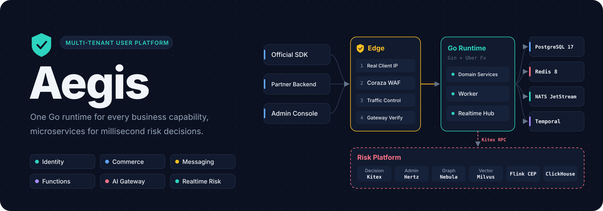
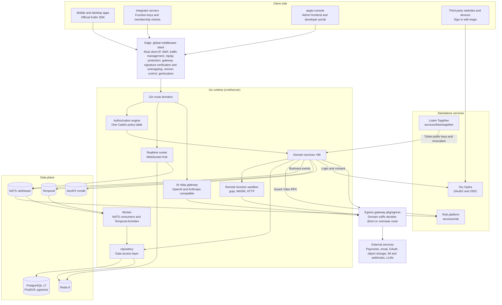
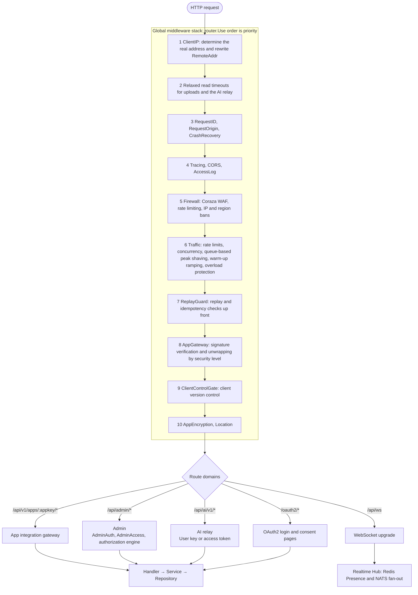
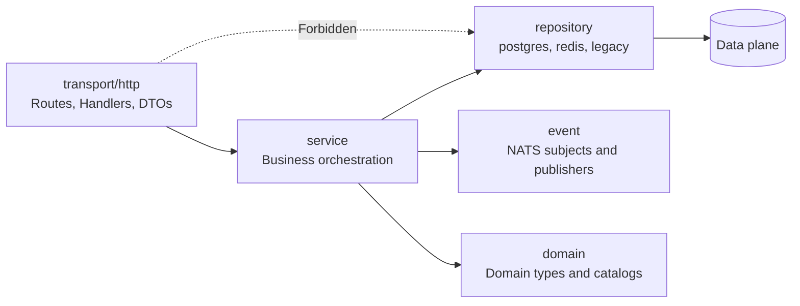
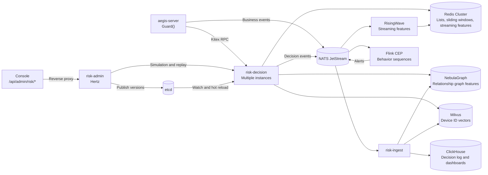

<div align="center">
  
</div>

<div align="center">

**Language:** **English** | [简体中文](README.zh-CN.md) | [日本語](README.ja.md)

[](https://go.dev/)
[](https://gin-gonic.com/)
[](https://www.cloudwego.io/)
[](https://www.postgresql.org/)
[](https://redis.io/)
[](https://nats.io/)
[](https://temporal.io/)
<br/>
[](https://www.nebula-graph.io/)
[](https://milvus.io/)
[](https://clickhouse.com/)
[](https://flink.apache.org/)
[](https://nextjs.org/)
[](LICENSE)
<br/>
[](https://github.com/MiChongs/aegis/actions/workflows/go-ci.yml)
[](https://github.com/MiChongs/aegis/actions/workflows/console-ci.yml)

**Aegis** is a production-oriented, multi-tenant user platform.<br/>
A single Go runtime carries every business capability, a set of independent microservices delivers millisecond-level real-time risk control,<br/>
and a Next.js console handles all operations and configuration. Integrators only need to know one API namespace.

<p>
  <a href="#overview">Overview</a> &nbsp;|&nbsp;
  <a href="#architecture">Architecture</a> &nbsp;|&nbsp;
  <a href="#risk-platform">Risk Platform</a> &nbsp;|&nbsp;
  <a href="#app-integration-protocol">Integration</a> &nbsp;|&nbsp;
  <a href="#capability-map">Capabilities</a> &nbsp;|&nbsp;
  <a href="#admin-console">Console</a> &nbsp;|&nbsp;
  <a href="#tech-stack">Tech Stack</a> &nbsp;|&nbsp;
  <a href="#quick-start">Quick Start</a> &nbsp;|&nbsp;
  <a href="#documentation">Docs</a>
</p>

</div>

---

## Overview

Sign-up and sign-in, sessions and devices, points and check-ins, wallets and memberships, payments and receipts,
tickets and notifications, risk control and auditing: nearly every product ends up rewriting these from scratch.
Aegis consolidates them into a single multi-tenant service isolated by `appid`. Integrators get a **protocol and SDK**,
and operators get a **console**, rather than a scaffold that every team has to build on further.

<table>
  <tr>
    <td width="33%" valign="top">
      <h4>One runtime</h4>
      <code>cmd/server</code> hosts the API and the Worker in one process; when needed, it splits into <code>cmd/api</code> and
      <code>cmd/worker</code> that scale independently, with assembly and dependency injection (Uber Fx) fully shared.
    </td>
    <td width="33%" valign="top">
      <h4>One isolation boundary</h4>
      Application boundaries are drawn by <code>appid</code>: users, sessions, caches, notifications, realtime channels, configuration, and secrets are all isolated per app,
      and cross-app reads and writes are explicitly blocked in the service layer.
    </td>
    <td width="33%" valign="top">
      <h4>One integration surface</h4>
      Clients only need <code>/api/v1/apps/{appKey}/*</code>: authentication, profiles, two-factor authentication, assets, content, tickets, and storage all live there,
      and the interface catalog is delivered in machine-readable form through <code>/config</code>.
    </td>
  </tr>
  <tr>
    <td width="33%" valign="top">
      <h4>Risk control as its own platform</h4>
      Decisions, relationship graphs, vectors, streaming features, and behavior sequences are handled by independent microservices under <code>services/risk</code>.
      The main service keeps only a thin <code>Guard</code> integration layer, so rule changes do not require redeploying it.
    </td>
    <td width="33%" valign="top">
      <h4>Catalog-driven</h4>
      Payment channels, email providers, OAuth channels, storage drivers, remote function capabilities, and risk features are all delivered by the server as <strong>self-describing catalogs</strong>.
      Console forms and validation share the same source, and nothing is hardcoded in the frontend.
    </td>
    <td width="33%" valign="top">
      <h4>Every setting needs an enforcement point</h4>
      Every persisted switch must be read by real code, and each concern has exactly one configuration entry point.
      A setting that is stored but never read is more dangerous than none at all: administrators will believe they are protected.
    </td>
  </tr>
</table>

### Engineering Snapshot

| Aspect | Current state |
| --- | --- |
| Main service | Go 1.26, Gin 1.12, pgx/v5, Uber Fx; can optionally terminate TLS itself and serve HTTP/3 (quic-go) |
| Risk platform | CloudWeGo Kitex + Hertz microservices: `risk-decision`, `risk-admin`, `risk-ingest`, plus a Flink CEP job |
| Admin frontend | Next.js 16, React 19, Tailwind CSS 4, shadcn/ui, TanStack Query, AntV G6 |
| Route count | 1600+ routes in the runtime route table, 215 of them in the app integration gateway (counted live by `go run ./cmd/server routes`) |
| Domain services | 86 services and 280+ source files under `internal/service/` |
| Database migrations | Applied in order from `migrations/postgres/`, `000001` through `000150` |
| Console | 43 page routes, including the public developer portal |
| Built-in channels | 16 payment, 9 email, 13 OAuth, 12 object storage, 6 captcha types |
| Official clients | `sdk/kotlin` (shared by Android and JVM servers), `mcp/` (an MCP server for AI assistants) |

---

## Architecture

### System Overview



**There is only one way out.** OAuth, payments, object storage, GeoIP updates, webhooks, email, and LLM upstreams all go through `pkg/egress`,
where a single routing table decides whether each domain connects directly or through an overseas route; when the gateway is off, everything connects directly. See [docs/egress-gateway.md](docs/egress-gateway.md).

### What a Request Passes Through



`ClientIP` must come first: access logs, rate limiting, bans, the WAF, traffic management, and geo risk checks downstream all rely on the address it computes.
Gin's built-in forwarded-header parsing is explicitly disabled (`SetTrustedProxies(nil)`) to avoid two competing determinations. Traffic management sits after Firewall and
before ReplayGuard: malicious traffic is rejected first, legitimate traffic is shaped next, and rejected requests do not consume nonces or idempotency keys.
See [docs/client-ip.md](docs/client-ip.md) and [docs/traffic-management.md](docs/traffic-management.md).

### Runtime Modes

| Entry point | Runs | Use case |
| --- | --- | --- |
| `cmd/server` | API and Worker in one process, plus all operational subcommands | Default mode, for single-node and small to medium deployments |
| `cmd/api` | HTTP and WebSocket only | When the access layer needs to scale independently |
| `cmd/worker` | NATS consumers and Temporal Worker only | Scaling background jobs and workflows independently |
| `services/risk/cmd/*` | `risk-decision`, `risk-admin`, `risk-ingest` | Risk platform, started with the compose `risk` profile |
| `services/listentogether` | Listen Together room service (WebSocket and Connect RPC) | Multi-user sync for online music listening |

The first three entry points share the same assembly and lifecycle in `internal/bootstrap`; they differ only in which components are enabled.

### Layers and Dependency Direction



Four hard constraints apply across the whole repository:

- **Handlers never call repositories directly**; all business decisions belong in the service layer.
- **All responses go through `pkg/response`** (`response.OK` and `response.Error`); no bare `c.JSON`.
- **Configuration comes only from `internal/config.Config`**; business code never calls `os.Getenv`.
- **Complex writes use explicit pgx transactions**, and all logging is structured zap output.

### Data Plane Responsibilities

| Component | Handles | Does not handle |
| --- | --- | --- |
| PostgreSQL 17 + PostGIS + pgvector | All transactional data, auditing, geofencing, and analytics | High-frequency counters and online presence |
| Redis 8 | Session indexes, caching, rate limiting, online presence, idempotency and replay protection, leaderboards, cluster quotas for traffic management | Source of truth for transactions |
| NATS JetStream | Event fan-out, cross-instance realtime delivery, Worker decoupling, risk event bus | Long-running transaction orchestration |
| Temporal | Workflow orchestration and retry semantics | Millisecond-level request paths |
| GeoIP2 mmdb | IP geolocation and ASN, auto-updated | Precise positioning |
| Legacy MySQL | Read-only migration source for the old Node.js system | Any online writes |

---

## Risk Platform

Risk control has been split out of the main service into a set of independent microservices under `services/risk`. The main service keeps only
`RiskService.Guard`, a thin integration layer: business call sites stay unchanged, and changes to rules, features, models, and decision flows take effect within seconds of being published in the console, without redeploying the main service.



| Component | Role in risk control |
| --- | --- |
| **CloudWeGo Kitex** | Decision RPC: multiplexed persistent connections and client-side load balancing, used on hot paths such as login, ordering, and lottery draws |
| **CloudWeGo Hertz** | Admin API for `risk-admin`, accessed by the console through a signed proxy in the main service |
| **etcd** | Service registration and discovery, configuration publishing channel (decision instances watch and hot reload), leader election for singleton jobs |
| **Redis Cluster** | Exact-match list indexes, real-time sliding-window counters, streaming features written back by RisingWave, graph and vector feature caches |
| **RisingWave** | Long-window aggregate features defined in SQL (for example, payment amount over 24 hours or device count over 7 days), written back to Redis Cluster |
| **Flink CEP** | Cross-event temporal patterns, such as "success after repeated failures" or "logging in from several devices shortly after registration" |
| **NebulaGraph** | Relationship graph of users, devices, IPs, network ranges, phone numbers, emails, invitations, third-party accounts, and payment accounts; decisions read graph features, and the user detail page draws the full relationship network |
| **Milvus** | Device ID vectors: candidates are recalled by device ID characters and then scored by edit distance, finding devices that differ by only one or two characters (batch-generated by scripts, or spoofed device IDs) |
| **ClickHouse** | Decision log (with full traces), business events, alerts, and disposition records; overview dashboards and per-user risk timelines |
| **expr-lang/expr** | Rule conditions and derived feature expressions, compiled once and evaluated without reflection |
| **gorules/zen-go** | Decision flows (JDM decision tables and decision graphs), edited visually in the console with `@gorules/jdm-editor` |
| **open-policy-agent/opa** | Final verdict guardrails (Rego): allowlist fallback, member protection, scenario scope for automatic bans |
| **dmitryikh/leaves** | LightGBM and XGBoost tree model inference, pure Go without CGO |

Some design trade-offs:

- **Observe and enforce are separate.** Each rule can be set to observe on its own: hits are recorded but do not affect the outcome. New scenarios are published in observe mode by default, and rules are switched to enforce one at a time after false positives have been reviewed.
- **Full relationship graph initialization.** On first startup, `risk-admin` backfills the relationship graph from the main database across 15 sources (registration, login, devices, third-party accounts, invitations, payments, and more), and the backfill can be rerun. Proxy and CDN addresses, placeholder device IDs, and UA digests never enter the graph. IPv6 addresses are modeled as one node per /64, so the rotating privacy addresses of a single phone are not treated as dozens of IPs.
- **Weak links do not propagate.** Data-center egress IPs and egress IPs shared by many people still appear on the graph, but they do not count toward graph features and are not expanded further.
- **9 identity and account-security integration points.** Beyond business scenarios such as login, registration, lottery, and payment, third-party login and binding, OAuth2 authorization, Passkey login, QR code login, password changes, contact rebinding, account deletion, and membership trials are all integrated, and events carry only digests of identifiers.

See [docs/risk-platform.md](docs/risk-platform.md).

---

## App Integration Protocol

Integrators only need to know one namespace: `/api/v1/apps/{appKey}/*`. It covers **every** capability a client actually needs after login:
the authentication lifecycle, profiles and settings, two-factor authentication and Passkey, sessions and auditing, check-ins, points, leaderboards, inbox messages, wallets, memberships, payments,
storage uploads, tickets, carousels, announcements, and version checks.

### Three Security Levels

All three levels share the same paths and the same JSON structure; only **how** the request is wrapped changes. Moving up a level replaces a single transport adapter, and business code stays untouched.

| Level | What the client does | Use case |
| --- | --- | --- |
| `standard` (default) | HTTPS and JSON, with no keys, no handshake, and no cryptography library | Regular workloads |
| `signed` | Additionally computes an HMAC-SHA256 request signature (v2, **covers the query string**) | Tamper protection |
| `sealed` | Adds a Transport v2 end-to-end encrypted payload on top of signed | Highly adversarial environments |

The levels are cumulative: `sealed = signed + encryption`. AEAD only proves the ciphertext was not modified (the server's public key is public, so anyone can produce valid ciphertext);
only the signature proves the caller holds the `appSecret`. Both are required.

| Request shape | How it is wrapped |
| --- | --- |
| With a body (POST, PUT) | Ciphertext goes in the body |
| Without a body (GET, DELETE, HEAD) | Ciphertext goes in `?_payload=`, and the plaintext is the real query string |
| Upload (multipart) | The entire multipart body is encrypted, and the original type is declared in `X-Aegis-Plain-Content-Type` |

### Sign-in Methods

Controlled per app by `loginMethods` and `registerMethods`; the two option sets are intentionally different:

| Method | Sign-in | Sign-up | Entry point |
| --- | :--: | :--: | --- |
| `password` | ✅ | ✅ | `/auth/login`, `/auth/register` (dispatched by the `method` field) |
| `sms` | ✅ | ✅ | Request a code from `/auth/sms/code` first, then use the same two entry points |
| `oauth` | ✅ | | `/auth/oauth/url` and `callback`, or native `exchange` |
| `cardkey` | ✅ | | `/auth/login`; the card is the credential, and first use creates an account and binds the card automatically |
| Passkey | ✅ | | WebAuthn; the platform-level relying party follows the accessed domain, and an app can also configure its own relying party |
| QR code | ✅ | | Confirmed by scanning from an already signed-in device, so the website and new devices need no password |

**Card keys have no separate sign-up switch** (cards are issued by operators, and issuing one means allowing it to create an account),
and **third-party login has no app-level sign-up switch** (whether accounts are created automatically is decided by each channel's own `allowRegister`).

### The Interface Catalog Is the Single Source of Truth

The interface catalog is defined in `internal/service/auth_protocol_catalog.go` and delivered in machine-readable form through `/config`
(`operations` carries methods and authentication requirements, and `errors` carries error codes and recovery actions). The catalog and the real routes are
**locked together in both directions** by `TestGatewayCatalogMatchesRegisteredRoutes`: an extra catalog entry makes generated clients call a 404,
and an extra route means that capability does not exist for generated clients.

The wrapping specification has four other real sources, and protocol changes must keep them in sync, or the console's "Integration self-check" reports errors immediately:

| Location | Role |
| --- | --- |
| `internal/service/auth_protocol_service.go` | Server-side validation |
| `internal/service/auth_protocol_selftest.go` | Reference client implementation (run live by the self-check) |
| `aegis-console/src/lib/integration-snippets.ts` | Sample code for integrators |
| `sdk/kotlin/.../AegisCanonical.kt` | The only place in the official SDK allowed to build protocol strings |

See [docs/app-integration.md](docs/app-integration.md) for the full specification.

---

## Capability Map

<table>
  <tr>
    <td width="50%" valign="top">

#### Identity and Authentication

| Capability | Description |
| --- | --- |
| Accounts | Six sign-in methods: password, SMS, third-party, card key, Passkey, and QR code |
| Sessions | JWT with a Redis session index, single-session revocation and sign-out everywhere |
| Two-factor authentication | TOTP, recovery codes, Passkey |
| Passwords | zxcvbn strength estimation, PRECIS normalization, complexity, expiry, and reuse-prevention policies |
| Captcha | Six types: static image, arithmetic, digits, audio, animated GIF, and chiral carbon |
| Admission | Complementary IP and device admission for registration, device count limits, login baselines, and rebinding cooldowns |
| Identity provider | Ory Hydra: lets other websites and devices "Sign in with Aegis" |
| Enterprise directory | Platform-level LDAP, OIDC, and SAML integration |

</td>
    <td width="50%" valign="top">

#### User Platform

| Capability | Description |
| --- | --- |
| Profiles and settings | User profiles, a random 16-digit public user ID, hosted user-side settings |
| Avatars | Permanent URLs, EXIF correction, multiple sizes, blurhash, self-rendered default avatars |
| Growth | Check-ins and auto check-in, points and experience, levels, reward and penalty multipliers, leaderboards |
| Invites and promotion | Invite codes and relationships, promotion campaign tiers and share review |
| Inbox | User notifications and an administrator inbox, with badge counts pushed over WebSocket |
| Account lifecycle | Bans and appeals, deletion cooling-off periods and tombstones |
| Organization | Organizations, departments, members, positions, organization roles, approval chains |
| Online statistics | An encrypted persistent admin connection pushes live online snapshots and sign-in and sign-out activity |

</td>
  </tr>
  <tr>
    <td width="50%" valign="top">

#### Assets and Transactions

| Capability | Description |
| --- | --- |
| Wallet | Balances, transactions, adjustments; all amounts use `shopspring/decimal` end to end |
| Membership | Plans, tiers, conversion, trials, server-side checks at feature granularity |
| Payments | 16 providers: internal wallet, Alipay, WeChat Pay, the Epay family, Afdian, Stripe, PayPal, Paddle, Lemon Squeezy, Square, Razorpay, Coinbase Commerce, and more |
| Manual review | Orders with mismatched amounts go to manual review; overpayments are accepted, and underpayments are held for handling |
| Receipts | PDF receipts for orders and wallet transactions, A4 layout in 10 languages |
| Card keys | Two forms, license cards and redemption cards, each code single-use |
| Engagement features | Lottery, points store, item grants, rewarded ads |

</td>
    <td width="50%" valign="top">

#### Content and Outreach

| Capability | Description |
| --- | --- |
| Content center | Carousel placements, app announcements, system announcements, sanitized on write |
| Email | Platform-level and app-level scopes, 9 providers, with signature verification for delivery receipts |
| Notification outlets | Subscription matching, template rendering, multi-channel delivery and retries; Feishu, DingTalk, WeCom, Slack, Webhook, email, inbox, real-time push |
| Tickets | Creation, replies, assignment, attachments, ratings, SLA timers |
| Releases and clients | Version releases and update checks, client version control, crash reports |
| Listen Together | Synchronized multi-user music listening rooms, with EdDSA tickets and membership entitlement checks |

</td>
  </tr>
  <tr>
    <td width="50%" valign="top">

#### Developer Capabilities

| Capability | Description |
| --- | --- |
| Remote functions | Integrators' custom logic runs in a server-side sandbox (goja, WASM, self-hosted HTTP) |
| Dry runs | Reads real data; write operations are recorded but not executed |
| Release gate | Static checks pinpoint "which line is missing which capability" |
| AI gateway | App users call OpenAI- and Anthropic-compatible APIs with their own keys, billed at model prices against quota, points, or balance; failed calls are not charged |
| MCP | Administrators issue MCP keys to AI assistants; permissions are the intersection of the holder's own permissions and the key's scope |
| Workflows | Temporal orchestration with a canvas editor in the console |
| Storage | 12 drivers: S3-compatible, Cloudflare R2, MinIO, Alibaba Cloud OSS, Tencent COS, Qiniu, Azure Blob, WebDAV, OneDrive, Google Drive, Dropbox, local |

</td>
    <td width="50%" valign="top">

#### Security and Operations

| Capability | Description |
| --- | --- |
| WAF | Coraza v3 with OWASP CRS v4, with searchable block logs |
| Traffic management | Built-in plugin: rate limiting, concurrency control, queue-based peak shaving, warm-up ramping, overload protection, with cluster quotas coordinated through Redis |
| Risk control | A standalone risk platform; see [above](#risk-platform) |
| Geo and bans | Impossible travel, new-country detection, PostGIS geofences; bans by IP, region, ASN, and carrier |
| Platform governance | Six app states and seven restrictions, each with an enforcement point |
| Authorization | One Casbin model and one policy table, with platform, app, and organization scopes |
| Transport | Optional self-terminated TLS: HTTPS over TCP and HTTP/3 over UDP on the same port |
| Observability | OpenTelemetry tracing, zap structured logs, crash logs written to disk, Prometheus metrics |

</td>
  </tr>
</table>

---

## Admin Console

`aegis-console/` is the Next.js 16 admin frontend that lives in the same repository as the backend and covers every operations and configuration task.

| Page | Purpose |
| --- | --- |
| `/overview` | System overview and real-time metrics |
| `/apps`, `/apps/{appKey}` | App list and **the single home for app-level configuration** (authentication and sessions, integration, OAuth, payments, membership, card keys, storage, and more) |
| `/app-users` | App users and per-user details (profile, security, assets, activity, risk and relationship network, rewards and penalties, dispositions) |
| `/users` | Administrators, online sessions, roles and permissions |
| `/organization` | Organizations, departments, members, positions, approvals |
| `/content`, `/releases`, `/client-control` | Content placement, version releases, client version control |
| `/commerce` | Orders, refunds, wallet transactions, memberships, receipts, manual review |
| `/functions`, `/workflows` | Remote function workbench (edit, check, dry run, publish, roll back) and the workflow canvas |
| `/storage`, `/templates`, `/plugins` | Storage management, message templates, plugin system |
| `/tickets`, `/feedback` | Ticket center, notification outlets, feedback |
| `/risk-control` | Risk platform: overview, decision log, reviews, lists, scenario workbench, features, behavior patterns, models, system |
| `/security`, `/traffic` | Security runtime state and traffic management |
| `/platform`, `/platform-banners`, `/configuration` | Platform governance, platform banners, and **the single home for platform-level configuration** |
| `/reviews`, `/roles`, `/audit`, `/reports` | Role request approvals, role management, audit logs, reports and analytics |
| `/developers` | Public developer portal (no login required): integration guides and interactive API documentation |

Configuration has only two scopes, each with a single home page: app-level settings live in `/apps/{appKey}`, and platform-level settings live in `/configuration`.
`/platform` holds not configuration but **the platform's enforced decisions about apps**; the two are combined with AND, and governance is evaluated first.

---

## Tech Stack

| Layer | Choice |
| --- | --- |
| Language and framework | Go 1.26, Gin 1.12, Uber Fx, Viper |
| Risk microservices | CloudWeGo Kitex, CloudWeGo Hertz, etcd |
| Primary database | PostgreSQL 17 + PostGIS 3 + pgvector (pgx/v5 connection pool), with sqlc progressively taking over queries |
| Cache and sessions | Redis 8 (go-redis v9); Redis Cluster on the risk side |
| Messaging and workflows | NATS JetStream, Temporal |
| Risk data | NebulaGraph, Milvus, ClickHouse, RisingWave, Apache Flink CEP, MinIO |
| Rules and policies | expr-lang/expr, gorules/zen-go, Open Policy Agent, dmitryikh/leaves |
| Authorization and identity | Casbin v2, Ory Hydra, go-webauthn, go-oidc, crewjam/saml, go-ldap |
| Security | Coraza v3 + OWASP CRS v4, in-house traffic management `pkg/traffic` |
| Transport | quic-go (HTTP/3), Gorilla WebSocket, Connect RPC |
| Script sandbox | goja, goja_nodejs, wazero |
| AI | openai-go, anthropic-sdk-go, google genai, CloudWeGo Eino, MCP Go SDK |
| Geo | GeoIP2 mmdb (auto-updated), PostGIS, orb |
| Documentation | kin-openapi (generated from the runtime route table, no annotations required) |
| Observability | OpenTelemetry, zap, Prometheus client |
| Admin frontend | Next.js 16, React 19, Tailwind CSS 4, shadcn/ui, TanStack Query, Zustand, Zod |
| Frontend graphics | AntV G6 (relationship networks), Recharts and ECharts (charts), React Flow (canvases), MapLibre (maps), Monaco (code editing), Motion |
| Frontend toolchain | Bun 1.4, TypeScript 6, ESLint 10, Node built-in test runner |

In-house shared packages (`pkg/`): `clientip` for the real client IP, `egress` for the egress gateway, `traffic` for the traffic management engine,
`httpserve` for TLS and HTTP/3, `hydra` for the Hydra admin client, `gifcaptcha` for animated captchas, `receipt` for payment receipt PDFs,
`fontkit` for font normalization, `i18n` for internationalization, `routetable` for route list rendering, `keyedgate` for per-key serialization,
`circuitbreaker`, `resilience`, and `taskpool` for resilience and concurrency, `crashlog` for crash logs, and `listenticket` for Listen Together tickets.

---

## Quick Start

### One-Command Deployment

```bash
# Linux and macOS: check the environment, generate a .env with strong random credentials, build images, start the full stack, run migrations, wait for health
./deploy/docker/quickstart.sh

./deploy/docker/quickstart.sh --infra      # Start only the infrastructure; run the services locally with go run
./deploy/docker/quickstart.sh --status     # Show stack status
./deploy/docker/quickstart.sh --down       # Stop and remove containers (data volumes are kept)
GOPROXY_CN=1 ./deploy/docker/quickstart.sh # Faster builds in mainland China
```

```powershell
# Windows PowerShell, with parameters matching the ones above one to one
.\deploy\docker\quickstart.ps1
.\deploy\docker\quickstart.ps1 -Infra
.\deploy\docker\quickstart.ps1 -Status
.\deploy\docker\quickstart.ps1 -Down
.\deploy\docker\quickstart.ps1 -GoproxyCN
```

Windows also has cmd wrapper scripts under `deploy/windows/`, and Linux also has `deploy.sh`, `start.sh`, `stop.sh`, and `status.sh` under `deploy/linux/`.

### Starting the Risk Platform

One-command deployment starts only the main service and the console. The risk platform lives in the `risk` profile of the same compose file:

```bash
docker compose -f deploy/docker/docker-compose.yml --profile risk up -d
```

This starts etcd, Redis Cluster, MinIO, Milvus, NebulaGraph, ClickHouse, RisingWave, Flink, and the three risk services,
with `risk-migrate` creating the databases and initializing them. For production orchestration see [deploy/dokploy/risk-stack.yml](deploy/dokploy/risk-stack.yml),
and for deployment steps see [docs/risk-deploy-hk.md](docs/risk-deploy-hk.md). The main service discovers the decision service through `RISK_ETCD_ENDPOINTS`;
when it is not configured, the risk integration layer lets every request through.

### Manual Startup

```bash
cp .env.example .env
docker compose -f deploy/docker/docker-compose.yml up -d   # postgres, redis, nats, temporal
go run ./cmd/server migrate                                # Apply migrations in order
go run ./cmd/server                                        # API and Worker
```

The server listens on `8088` by default: health check at `GET /healthz`, readiness check at `GET /readyz`, and API documentation at `GET /openapi.json`.

### Admin Frontend

```bash
cd aegis-console
bun install
bun run dev      # Development server, port 3000 by default, with /api reverse-proxied same-origin to the backend
bun run build    # Production build: tsc --noEmit, then next build
```

`aegis-console/.env.local` requires `NEXT_PUBLIC_API_BASE_URL`. In container builds the backend address is **baked in at build time** (`AEGIS_API_BACKEND`),
so changing the address requires rebuilding the image.

### Required Environment Variables

| Variable | Description |
| --- | --- |
| `JWT_SECRET` | JWT signing key |
| `POSTGRES_DSN` | PostgreSQL connection string |
| `REDIS_ADDR` | Redis address |
| `NATS_URL` | NATS connection URL |
| `ADMIN_API_TOKEN` | Static admin token |
| `ADMIN_BOOTSTRAP_*` | Initial super administrator account (username, password, display name, email) |

Optional settings worth confirming separately (see `.env.example` for the full list, each with a description):

| Variable | Why it is worth confirming |
| --- | --- |
| `TRUSTED_PROXIES`, `CLIENT_IP_*` | Rate limiting, bans, geo risk checks, the relationship graph, and auditing all rely on the address it computes; **a wrong setting raises no error, it just stops working** |
| `API_BASE_URL`, `CONSOLE_BASE_URL` | Receipt emails and notification deep links need absolute URLs |
| `RISK_ETCD_ENDPOINTS`, `RISK_TIMEOUT` | Discovery address and timeout for the risk decision service; the risk platform's trusted proxy ranges must match `TRUSTED_PROXIES` |
| `TLS_ENABLED`, `TLS_*` | Terminate TLS yourself and enable HTTP/3; usually unnecessary behind a CDN |
| `EGRESS_*` | Egress gateway; when off, everything connects directly |
| `TEMPORAL_*` | Workflow engine address and timeouts |

---

## Common Commands

### Main Service

```bash
go run ./cmd/server                 # API and Worker
go run ./cmd/api                    # API only
go run ./cmd/worker                 # Worker only

go run ./cmd/server migrate                          # Database migrations
go run ./cmd/server openapi docs/openapi.json        # Export OpenAPI
go run ./cmd/server postman                          # Export a Postman collection
go run ./cmd/server routes                           # Route list (no database connection)
go run ./cmd/server routes --format tree --group 管理端
go run ./cmd/server mock-users                       # Generate demo data

go run ./cmd/server sync-legacy-user <user_id>       # Legacy system migration
go run ./cmd/server sync-legacy-batch [lastID] [limit]
go run ./cmd/server import-dump <dump.sql> --appid <id> --password <shared-password> [--dry-run]

go test ./...
```

### Risk Platform

```bash
cd services/risk
go test ./...
go run ./cmd/risk-admin graph-backfill    # Backfill the relationship graph and device ID vectors from the main database (can be rerun)
```

The console's Risk › System page can also start a backfill and show step-by-step progress.

### Code Generation (outputs must be committed; CI checks that they are up to date)

```bash
sqlc generate                             # After changing migrations/ or sql/queries/
sqlc vet && sqlc diff

go generate ./internal/transport/http/    # Regenerate the route-to-request-model mapping table
go run ./scripts/docsgen -check

python3 scripts/banner/generate.py        # Regenerate the README banners
```

### Container Builds

```bash
docker build -f deploy/docker/Dockerfile -t aegis-server .
docker build -f deploy/docker/Dockerfile --build-arg WITH_CJK_FONTS=0 -t aegis-server .   # Without CJK fonts, for a smaller image

docker build -f deploy/docker/console.Dockerfile \
  --build-arg AEGIS_API_BACKEND=http://aegis-server:8088 \
  -t aegis-console aegis-console

docker build -f deploy/docker/risk.Dockerfile -t aegis-risk .          # One image shared by the three risk services
docker build -f deploy/docker/risk-cep.Dockerfile -t aegis-risk-cep .  # Flink CEP job
```

---

## Directory Structure

```text
cmd/
  api/  server/  worker/        Three entry points; server also contains all operational subcommands
internal/
  authz/                        Authorization engine: Casbin model, permission vocabulary, built-in roles, policy storage
  bootstrap/                    App assembly (Uber Fx), lifecycle, CLI commands, HTTPS and HTTP/3
  config/                       Configuration structs and loading
  db/                           postgres, redis, nats, temporal, legacy mysql clients
  domain/                       Domain types and self-describing catalogs
  event/                        NATS event subjects and publishers
  middleware/                   Client IP, firewall, integration gateway, authentication, encryption, auditing
  nativeplugin/  plugins/       Built-in plugin host and the plugins themselves (traffic management)
  repository/                   Data access layer (including sqlc outputs)
  service/                      Business orchestration: 86 domain services
  transport/http/               Route domains, Handlers, DTOs, OpenAPI generation
services/
  risk/                         Risk platform: cmd/risk-{decision,admin,ingest}, internal/*, cep/
  listentogether/               Listen Together room service
pkg/                            In-house shared packages (see the Tech Stack section)
migrations/postgres/            Ordered SQL migrations (000001 through 000150)
sql/queries/                    sqlc query sources
sdk/kotlin/                     Official Kotlin/JVM client
mcp/                            Aegis MCP server (Python)
aegis-console/                  Next.js 16 admin frontend and developer portal
deploy/
  docker/                       Dockerfiles, compose, quickstart, custom postgres image
  dokploy/                      Production orchestration for the risk platform
  linux/  windows/              Deployment scripts
scripts/                        Tools such as docsgen and banner generation
docs/                           Protocol, capability, and operations documentation
```

---

## Documentation

### API Documentation

| Artifact | Location |
| --- | --- |
| API documentation UI | Console `/developers/api`, with interactive debugging |
| OpenAPI JSON | `GET /openapi.json`, or a static export with `go run ./cmd/server openapi docs/openapi.json` |
| Postman collection | `go run ./cmd/server postman` |
| Route list | `go run ./cmd/server routes` (table, tree, Markdown, CSV, HTML, JSON) |

OpenAPI is generated by `kin-openapi` from the **runtime route table**, and request models are inferred by `scripts/docsgen` through static analysis with `x/tools`:
Gin's Handler signature erases the types, so no OpenAPI library can do this for you.

### Topic Guides

| Topic | Documents |
| --- | --- |
| Integration and protocol | [app-integration](docs/app-integration.md), [user-auth-and-app-transport-encryption](docs/user-auth-and-app-transport-encryption.md), [client-ip](docs/client-ip.md), [http3](docs/http3.md) |
| Identity and accounts | [passkey](docs/passkey.md), [oauth2-provider](docs/oauth2-provider.md), [account-setup](docs/account-setup.md), [register-ip](docs/register-ip.md), [device-limit](docs/device-limit.md), [account-deletion](docs/account-deletion.md), [user-public-id](docs/user-public-id.md) |
| Risk control and security | [risk-platform](docs/risk-platform.md), [risk-deploy-hk](docs/risk-deploy-hk.md), [traffic-management](docs/traffic-management.md), [platform-governance](docs/platform-governance.md), [egress-gateway](docs/egress-gateway.md) |
| Growth and engagement | [levels](docs/levels.md), [growth-control](docs/growth-control.md), [auto-sign](docs/auto-sign.md), [leaderboard](docs/leaderboard.md), [invite](docs/invite.md), [promo](docs/promo.md), [lottery](docs/lottery.md), [points-store](docs/points-store.md), [item-grant](docs/item-grant.md), [rewarded-ads](docs/rewarded-ads.md), [ad-policy](docs/ad-policy.md) |
| Transactions and membership | [vip-tiers](docs/vip-tiers.md), [vip-conversion](docs/vip-conversion.md), [card-key](docs/card-key.md), [payment-receipt](docs/payment-receipt.md), [payment-review](docs/payment-review.md) |
| Content and outreach | [email](docs/email.md), [notification-center](docs/notification-center.md), [feature-ticket](docs/feature-ticket.md), [releases](docs/releases.md), [client-control](docs/client-control.md), [crash-reports](docs/crash-reports.md), [online-live](docs/online-live.md), [listen-together](docs/listen-together.md) |
| Developer capabilities | [app-functions](docs/app-functions.md), [ai-gateway](docs/ai-gateway.md), [mcp](docs/mcp.md), [storage](docs/storage.md), [cloud-storage](docs/cloud-storage.md), [avatar](docs/avatar.md) |
| Engineering and data | [database](docs/database.md), [sqlc](docs/sqlc.md), [organization](docs/organization.md), [import-nodejs-dump](docs/import-nodejs-dump.md) |

The repository also contains layered `CLAUDE.md` files (at the root and under each major module) that record the **rationale and hard constraints** behind each design; reading them before changing the corresponding module is recommended.

---

## Testing and CI

```bash
go test ./...                                                            # Main service
(cd services/risk && go test ./...)                                      # Risk platform
cd aegis-console && bun run typecheck && bun run build && bun run test   # Admin frontend
```

| Workflow | Checks |
| --- | --- |
| [`go-ci.yml`](.github/workflows/go-ci.yml) | `go test ./...`; `sqlc vet` and `sqlc diff`; `docsgen -check` |
| [`console-ci.yml`](.github/workflows/console-ci.yml) | `bun run typecheck`, ESLint on files changed in the commit, `bun run build` |

Several key invariants are locked down directly by tests and fail first when changed: the interface catalog matches the real routes in both directions,
`/api/admin/platform/*` is always authorized with global scope, the full route table matches its snapshot, and the protocol canonical strings are byte-for-byte identical to the Kotlin SDK.

---

## Security Notes

- Never commit `.env` or any production secrets. Secret fields in the admin console always follow "leave blank to keep unchanged" and are never echoed back when editing.
- App secrets, channel secrets, SP private keys, and similar values are encrypted before being stored, and APIs return only `hasXxx` boolean flags.
- All external responses are sanitized through `pkg/response` and never expose internal runtime details or stack traces.
- The remote function sandbox denies by default: undeclared capabilities do not exist in the script. The HTTP runtime enforces HTTPS, forbids redirects,
  and re-resolves the IP at connection time, rejecting private network and cloud metadata addresses.
- Risk events carry only digests of identifiers such as phone numbers, emails, and third-party accounts, never plaintext.
- Rate limiting, bans, geo risk checks, the relationship graph, and auditing all depend on the real client IP. Before deploying, confirm `TRUSTED_PROXIES` according to [docs/client-ip.md](docs/client-ip.md):
  a wrong value raises no error and silently disables all of these capabilities at once.

## License

This project is licensed under a proprietary license. Commercial use and redistribution are prohibited without written permission. See [LICENSE](LICENSE) for the full text.
