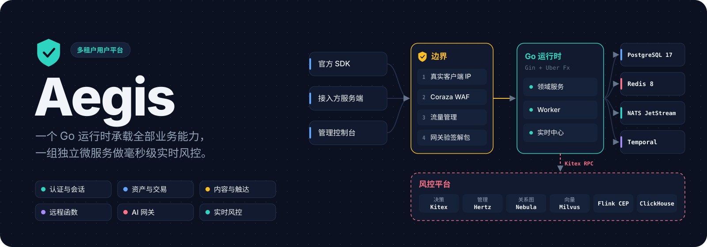
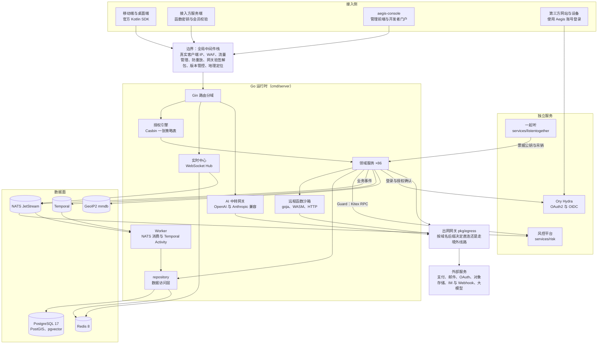
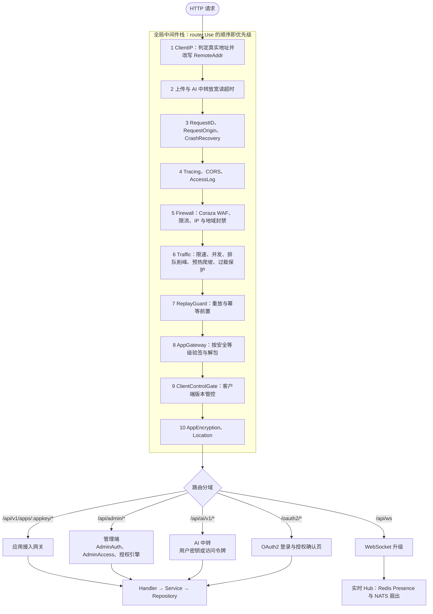
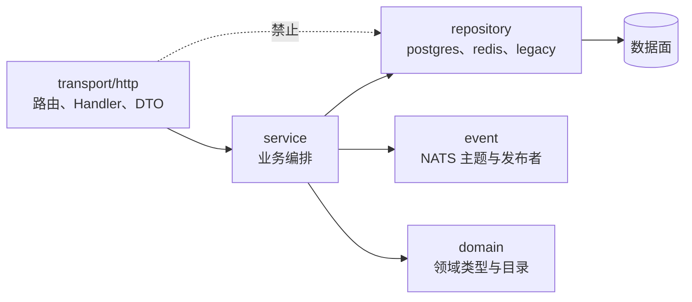
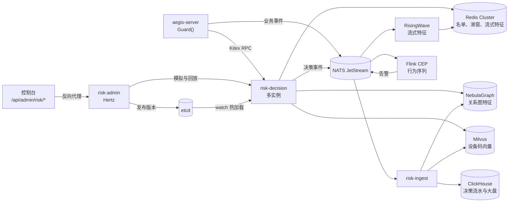

<div align="center">
  
</div>

<div align="center">

**语言：** [English](README.md) | **简体中文** | [日本語](README.ja.md)

[](https://go.dev/)
[](https://gin-gonic.com/)
[](https://www.cloudwego.io/)
[](https://www.postgresql.org/)
[](https://redis.io/)
[](https://nats.io/)
[](https://temporal.io/)
<br/>
[](https://www.nebula-graph.io/)
[](https://milvus.io/)
[](https://clickhouse.com/)
[](https://flink.apache.org/)
[](https://nextjs.org/)
[](LICENSE)
<br/>
[](https://github.com/MiChongs/aegis/actions/workflows/go-ci.yml)
[](https://github.com/MiChongs/aegis/actions/workflows/console-ci.yml)

**Aegis** 是一套面向生产环境的多租户用户平台。<br/>
一个 Go 运行时承载全部业务能力，一组独立微服务做毫秒级实时风控，<br/>
一个 Next.js 控制台承载全部运营与配置，接入方只需要认识一个 API 命名空间。

<p>
  <a href="#平台概况">平台概况</a> &nbsp;|&nbsp;
  <a href="#架构">架构</a> &nbsp;|&nbsp;
  <a href="#风控平台">风控平台</a> &nbsp;|&nbsp;
  <a href="#应用接入协议">接入协议</a> &nbsp;|&nbsp;
  <a href="#能力地图">能力地图</a> &nbsp;|&nbsp;
  <a href="#管理控制台">控制台</a> &nbsp;|&nbsp;
  <a href="#技术栈">技术栈</a> &nbsp;|&nbsp;
  <a href="#快速开始">快速开始</a> &nbsp;|&nbsp;
  <a href="#文档索引">文档</a>
</p>

</div>

---

## 平台概况

注册登录、会话与设备、积分与签到、钱包与会员、支付与凭证、工单与通知、风控与审计，
几乎每个产品都要把这些重写一遍。Aegis 把它们收成一套按 `appid` 隔离的多租户服务：
接入方拿到的是**协议与 SDK**，运营方拿到的是**控制台**，而不是一份需要各自二次开发的脚手架。

<table>
  <tr>
    <td width="33%" valign="top">
      <h4>一个运行时</h4>
      <code>cmd/server</code> 同进程承载 API 与 Worker；需要时拆成 <code>cmd/api</code> 与
      <code>cmd/worker</code> 独立伸缩，装配与依赖注入（Uber Fx）完全共用。
    </td>
    <td width="33%" valign="top">
      <h4>一条隔离线</h4>
      以 <code>appid</code> 划分应用边界：用户、会话、缓存、通知、实时链路、配置与密钥全部按应用隔离，
      跨应用读写在 service 层被显式拦截。
    </td>
    <td width="33%" valign="top">
      <h4>一个接入面</h4>
      客户端只需要 <code>/api/v1/apps/{appKey}/*</code>：认证、资料、二次认证、资产、内容、工单、存储全在其中，
      接口目录随 <code>/config</code> 机器可读地下发。
    </td>
  </tr>
  <tr>
    <td width="33%" valign="top">
      <h4>风控独立成平台</h4>
      决策、关系图、向量、流式特征、行为序列由 <code>services/risk</code> 下的独立微服务承担，
      主服务只保留一层很薄的 <code>Guard</code> 接入，规则改动不需要重新部署主服务。
    </td>
    <td width="33%" valign="top">
      <h4>目录驱动</h4>
      支付渠道、邮件服务商、OAuth 渠道、存储驱动、远程函数能力、风控特征都由服务端<strong>自述目录</strong>下发，
      控制台表单与校验共用同一份，前端不硬编码。
    </td>
    <td width="33%" valign="top">
      <h4>配置必须有执行点</h4>
      任何落库的开关都必须有代码真正读它，同一件事只允许一个配置入口。
      只存不读的配置比没有更危险：管理员会以为已经防住了。
    </td>
  </tr>
</table>

### 工程快照

| 维度 | 现状 |
| --- | --- |
| 主服务 | Go 1.26、Gin 1.12、pgx/v5、Uber Fx；可选自行终止 TLS 并提供 HTTP/3（quic-go） |
| 风控平台 | CloudWeGo Kitex + Hertz 微服务：`risk-decision`、`risk-admin`、`risk-ingest`，外加 Flink CEP 作业 |
| 管理前端 | Next.js 16、React 19、Tailwind CSS 4、shadcn/ui、TanStack Query、AntV G6 |
| 路由规模 | 运行时路由表 1600+ 条，其中应用接入网关 215 条（`go run ./cmd/server routes` 实时统计） |
| 领域服务 | `internal/service/` 下 86 个服务、280+ 个源文件 |
| 数据库迁移 | `migrations/postgres/` 顺序执行，`000001` 至 `000150` |
| 控制台 | 43 个页面路由，含公开的开发者门户 |
| 内置渠道 | 支付 16、邮件 9、OAuth 13、对象存储 12、验证码 6 档 |
| 官方客户端 | `sdk/kotlin`（Android 与 JVM 服务端共用）、`mcp/`（给 AI 助手用的 MCP 服务） |

---

## 架构

### 系统全景



**出网只有一个口子。** OAuth、支付、对象存储、GeoIP 更新、Webhook、邮件、大模型上游全部经 `pkg/egress`，
由同一张路由表决定每个域名是直连还是走境外线路；网关关闭时全部直连。详见 [docs/egress-gateway.md](docs/egress-gateway.md)。

### 一个请求要穿过什么



`ClientIP` 必须排在第一位：之后的访问日志、限流、封禁、WAF、流量管理、地理风控全部建立在它算出来的地址上。
Gin 自带的转发头解析被显式关掉（`SetTrustedProxies(nil)`），避免两套判定。流量管理排在 Firewall 之后、
ReplayGuard 之前：先拒绝恶意流量，再整形合法流量，被拒的请求不占用 Nonce 与幂等键。
详见 [docs/client-ip.md](docs/client-ip.md) 与 [docs/traffic-management.md](docs/traffic-management.md)。

### 运行形态

| 入口 | 承载 | 适用 |
| --- | --- | --- |
| `cmd/server` | API 与 Worker 同进程，另含全部运维子命令 | 默认形态，单机与中小规模部署 |
| `cmd/api` | 只跑 HTTP 与 WebSocket | 需要独立伸缩接入层时 |
| `cmd/worker` | 只跑 NATS 消费与 Temporal Worker | 后台任务与工作流独立扩容 |
| `services/risk/cmd/*` | `risk-decision`、`risk-admin`、`risk-ingest` | 风控平台，按 compose `risk` profile 启动 |
| `services/listentogether` | 一起听房间服务（WebSocket 与 Connect RPC） | 在线听歌的多人同步 |

前三个入口共用 `internal/bootstrap` 的同一套装配与生命周期，差别只在启用哪些组件。

### 分层与依赖方向



四条硬约束贯穿全仓库：

- **Handler 不直连 repository**，业务判断一律下沉到 service。
- **响应统一走 `pkg/response`**（`response.OK` 与 `response.Error`），不写裸 `c.JSON`。
- **配置只来自 `internal/config.Config`**，业务代码不调用 `os.Getenv`。
- **复杂写操作使用 pgx 显式事务**，日志一律 zap 结构化输出。

### 数据面职责划分

| 组件 | 承担 | 不承担 |
| --- | --- | --- |
| PostgreSQL 17 + PostGIS + pgvector | 全部事务数据、审计、地理围栏与分析 | 高频计数与在线状态 |
| Redis 8 | 会话索引、缓存、限流、在线状态、幂等与防重放、排行榜、流量管理的集群配额 | 事务的真实来源 |
| NATS JetStream | 事件扇出、跨实例实时投递、Worker 解耦、风控事件总线 | 长事务编排 |
| Temporal | 工作流编排与重试语义 | 毫秒级请求路径 |
| GeoIP2 mmdb | IP 归属与 ASN，自动更新 | 精确定位 |
| 遗留 MySQL | 旧 Node.js 系统的只读迁移源 | 任何在线写入 |

---

## 风控平台

风控从主服务里拆了出来，成为 `services/risk` 下的一组独立微服务。主服务只保留 `RiskService.Guard`
这一层很薄的接入：业务调用点不变，规则、特征、模型、决策流的改动在控制台发布后秒级生效，不需要重新部署主服务。



| 组件 | 在风控里做什么 |
| --- | --- |
| **CloudWeGo Kitex** | 决策 RPC：长连接多路复用与客户端负载均衡，登录、下单、抽奖等热路径都要走 |
| **CloudWeGo Hertz** | `risk-admin` 的管理接口，控制台经主服务签名代理访问 |
| **etcd** | 服务注册发现、配置发布通道（决策实例 watch 热加载）、单例任务选主 |
| **Redis Cluster** | 名单精确值索引、实时滑窗计数、RisingWave 写回的流式特征、图与向量特征缓存 |
| **RisingWave** | 用 SQL 定义长窗口聚合特征（如 24 小时支付金额、7 天设备数），写回 Redis Cluster |
| **Flink CEP** | 跨事件时序模式，如「失败多次后成功」「注册后短时间内换多台设备登录」 |
| **NebulaGraph** | 用户、设备、IP、网段、手机、邮箱、邀请、第三方账号、付款账号的关系图；决策取图特征，用户详情页画完整关系网络 |
| **Milvus** | 设备码向量：先按设备码字符召回，再按编辑距离打分，找出只差一两个字符的设备（脚本批量生成、改机改码） |
| **ClickHouse** | 决策流水（含完整轨迹）、业务事件、告警、处置记录；总览大盘与用户风险时间线 |
| **expr-lang/expr** | 规则条件与派生特征表达式，编译一次、零反射求值 |
| **gorules/zen-go** | 决策流（JDM 决策表与决策图），控制台用 `@gorules/jdm-editor` 可视化编辑 |
| **open-policy-agent/opa** | 最终裁决护栏（Rego）：白名单兜底、会员保护、自动封禁的场景范围 |
| **dmitryikh/leaves** | LightGBM 与 XGBoost 树模型推理，纯 Go 无 CGO |

几个设计取舍：

- **观察与生效分离。** 每条规则可单独设为观察：只记录命中，不影响结果。新场景默认以观察模式发布，核对误报后再逐条转为生效。
- **关系图完整初始化。** `risk-admin` 首次启动时从主库按 15 个来源回灌关系图（注册、登录、设备、第三方账号、邀请、支付……），可重复执行；代理与 CDN 地址、占位设备码、UA 摘要不会进图。IPv6 按 /64 线路建点，同一部手机轮换的隐私地址不会被当成几十个 IP。
- **弱关系不扩散。** 机房出口与多人共用的出口 IP 在图上照常显示，但不参与图特征统计，也不从它们继续展开。
- **9 个身份与账号安全接入点。** 除登录、注册、抽奖、支付等业务场景外，第三方登录与绑定、OAuth2 授权、Passkey 登录、扫码登录、改密、换绑联系方式、注销、会员试用都已接入，事件只带标识的摘要。

详见 [docs/risk-platform.md](docs/risk-platform.md)。

---

## 应用接入协议

接入方只需要认识一个命名空间：`/api/v1/apps/{appKey}/*`。它覆盖登录之后客户端真正要用的**全部**能力：
认证生命周期、资料与设置、二次认证与 Passkey、会话与审计、签到、积分、排行榜、站内信、钱包、会员、支付、
存储上传、工单、轮播图、公告、版本检查。

### 三档安全等级

三档共用同一批路径与同一份 JSON 结构，只改变请求**怎么包装**；升档只替换一层 transport 适配器，业务代码不动。

| 等级 | 客户端要做的事 | 适用 |
| --- | --- | --- |
| `standard`（默认） | HTTPS 与 JSON，无密钥、无握手、无密码学库 | 常规业务 |
| `signed` | 额外算一个 HMAC-SHA256 请求签名（v2，**覆盖 query string**） | 防篡改 |
| `sealed` | 在 signed 之上再叠 Transport v2 端到端加密载荷 | 强对抗环境 |

等级是累加的：`sealed = signed + 加密`。AEAD 只证明密文没被改过（服务端公钥公开，谁都能造合法密文），
签名才证明调用方持有 `appSecret`，两者缺一不可。

| 请求形状 | 怎么包装 |
| --- | --- |
| 有请求体（POST、PUT） | 密文走 body |
| 无请求体（GET、DELETE、HEAD） | 密文走 `?_payload=`，明文是真正的 query string |
| 上传（multipart） | 整个 multipart 体加密，原始类型由 `X-Aegis-Plain-Content-Type` 声明 |

### 登录方式

由每个应用的 `loginMethods` 与 `registerMethods` 控制，两者可选集合刻意不同：

| 方式 | 登录 | 注册 | 入口 |
| --- | :--: | :--: | --- |
| `password` | ✅ | ✅ | `/auth/login`、`/auth/register`（`method` 字段分流） |
| `sms` | ✅ | ✅ | 先 `/auth/sms/code` 取码，再走同两个入口 |
| `oauth` | ✅ | | `/auth/oauth/url` 与 `callback`，或原生 `exchange` |
| `cardkey` | ✅ | | `/auth/login`，卡即凭证，首次使用自动建号并绑卡 |
| Passkey | ✅ | | WebAuthn；平台级依赖方跟随访问域名，也可为应用配置独立依赖方 |
| 扫码 | ✅ | | 已登录的设备扫码确认，官网与新设备免输密码 |

**卡密没有独立的注册开关**（卡是运营发出去的，发出去就意味着允许它建号），
**第三方登录没有应用级注册开关**（能否自动建号由每个渠道自己的 `allowRegister` 决定）。

### 接口目录是单一事实源

接口目录写在 `internal/service/auth_protocol_catalog.go`，随 `/config` 以机器可读形式下发
（`operations` 带方法与鉴权要求，`errors` 带错误码与恢复动作）。目录与真实路由由
`TestGatewayCatalogMatchesRegisteredRoutes` **双向钉死**：目录多一条，生成式客户端会调出 404；
路由多一条，那个能力对生成式客户端就不存在。

包装规格另有四处真实来源，改协议必须同步，否则控制台的「接入自检」会立刻报错：

| 位置 | 角色 |
| --- | --- |
| `internal/service/auth_protocol_service.go` | 服务端校验 |
| `internal/service/auth_protocol_selftest.go` | 参考客户端实现（自检实跑） |
| `aegis-console/src/lib/integration-snippets.ts` | 给接入方的示例代码 |
| `sdk/kotlin/.../AegisCanonical.kt` | 官方 SDK 里唯一允许拼协议字符串的地方 |

完整规格见 [docs/app-integration.md](docs/app-integration.md)。

---

## 能力地图

<table>
  <tr>
    <td width="50%" valign="top">

#### 身份与认证

| 能力 | 说明 |
| --- | --- |
| 账号体系 | 密码、短信、第三方、卡密、Passkey、扫码六种登录 |
| 会话 | JWT 与 Redis 会话索引，单条撤销与全量下线 |
| 二次认证 | TOTP、恢复码、Passkey |
| 密码 | zxcvbn 强度估算、PRECIS 归一化、复杂度与过期与防重用策略 |
| 验证码 | 静态图形、算术、数字、音频、动态 GIF、手性碳六档 |
| 准入 | 注册 IP 与设备互补准入、设备数上限、登录基线与换绑冷却 |
| 身份提供方 | Ory Hydra：让其他网站与设备「使用 Aegis 账号登录」 |
| 企业目录 | LDAP、OIDC、SAML 平台级接入 |

</td>
    <td width="50%" valign="top">

#### 用户平台

| 能力 | 说明 |
| --- | --- |
| 资料与设置 | 用户资料、对外 16 位数字的随机公开 ID、用户端设置托管 |
| 头像 | 永久地址、EXIF 纠正、多尺寸、blurhash、默认头像自绘 |
| 成长 | 签到与自动签到、积分与经验、等级、奖惩倍率、排行榜 |
| 邀请与推广 | 邀请码与关系、推广活动档位与分享审核 |
| 站内信 | 用户通知与管理员收件箱，角标经 WebSocket 推送 |
| 账号生命周期 | 封禁与申诉、注销冷静期与墓碑 |
| 组织架构 | 组织、部门、成员、岗位、组织角色、审批链 |
| 在线统计 | 管理端加密长连接实时推送在线快照与上下线动态 |

</td>
  </tr>
  <tr>
    <td width="50%" valign="top">

#### 资产与交易

| 能力 | 说明 |
| --- | --- |
| 钱包 | 余额、流水、调账，金额全程 `shopspring/decimal` |
| 会员 | 套餐、档位、折算、试用、功能粒度的服务端校验 |
| 支付 | 16 个提供方：内部钱包、支付宝、微信支付、易支付系、爱发电、Stripe、PayPal、Paddle、Lemon Squeezy、Square、Razorpay、Coinbase Commerce 等 |
| 人工审核 | 金额不符的订单进入人工复核，多付照收、少付待处理 |
| 凭证 | 订单与钱包流水出 PDF 凭证，10 语言 A4 排版 |
| 卡密 | 授权卡与兑换卡两种形态，一码一用 |
| 运营玩法 | 抽奖、积分商城、物品发放、激励广告 |

</td>
    <td width="50%" valign="top">

#### 内容与触达

| 能力 | 说明 |
| --- | --- |
| 内容中心 | 轮播投放位、应用公告、系统公告，写入时净化 |
| 邮件 | 平台级与应用级两种作用域，9 家服务商与投递回执验签 |
| 通知出口 | 订阅匹配、模板渲染、多渠道投递与重试；飞书、钉钉、企业微信、Slack、Webhook、邮件、站内信、实时推送 |
| 工单 | 建单、回复、指派、附件、评价、SLA 计时 |
| 版本与客户端 | 版本发布与更新检查、客户端版本管控、崩溃报告 |
| 一起听 | 多人同步听歌房间，EdDSA 票据与会员权益校验 |

</td>
  </tr>
  <tr>
    <td width="50%" valign="top">

#### 开发者能力

| 能力 | 说明 |
| --- | --- |
| 远程函数 | 接入方的自定义逻辑跑在服务端沙箱（goja、WASM、自建 HTTP） |
| 试跑 | 读真实数据、写操作只记录不执行 |
| 发布门禁 | 静态检查指出「第几行缺哪项能力」 |
| AI 网关 | 应用用户凭自己的密钥调用 OpenAI 与 Anthropic 兼容接口，按模型价格从额度、积分、余额扣费，失败不扣费 |
| MCP | 管理员给 AI 助手签发 MCP 密钥，权限取本人权限与密钥范围的交集 |
| 工作流 | Temporal 编排与控制台画布编辑器 |
| 存储 | 12 种驱动：S3 兼容、Cloudflare R2、MinIO、阿里云 OSS、腾讯 COS、七牛、Azure Blob、WebDAV、OneDrive、Google Drive、Dropbox、本地 |

</td>
    <td width="50%" valign="top">

#### 安全与运维

| 能力 | 说明 |
| --- | --- |
| WAF | Coraza v3 与 OWASP CRS v4，拦截日志可查 |
| 流量管理 | 内置插件：限速、并发控制、排队削峰、预热爬坡、过载保护，集群配额经 Redis 协调 |
| 风控 | 独立的风控平台，见[上文](#风控平台) |
| 地理与封禁 | 不可能旅行、新国家、PostGIS 围栏；IP、地域、ASN、运营商封禁 |
| 平台治理 | 六档应用状态与七项限制，每项都有执行点 |
| 授权 | 一份 Casbin 模型、一张策略表，平台、应用、组织三种作用域 |
| 传输 | 可自行终止 TLS：同端口 TCP 跑 HTTPS，UDP 跑 HTTP/3 |
| 可观测 | OpenTelemetry 追踪、zap 结构化日志、崩溃日志落盘、Prometheus 指标 |

</td>
  </tr>
</table>

---

## 管理控制台

`aegis-console/` 是与后端同仓的 Next.js 16 管理前端，覆盖全部运营与配置动作。

| 页面 | 承担 |
| --- | --- |
| `/overview` | 系统总览与实时指标 |
| `/apps`、`/apps/{appKey}` | 应用列表与**应用级配置的唯一归属地**（认证与会话、接入、OAuth、支付、会员、卡密、存储……） |
| `/app-users` | 应用用户与单用户详情（资料、安全、资产、活动、风险与关系网络、奖惩、处置） |
| `/users` | 管理员、在线会话、角色权限 |
| `/organization` | 组织、部门、成员、岗位、审批 |
| `/content`、`/releases`、`/client-control` | 内容投放、版本发布、客户端版本管控 |
| `/commerce` | 订单、退款、钱包流水、会员、凭证、人工审核 |
| `/functions`、`/workflows` | 远程函数工作台（编辑、检查、试跑、发布、回滚）与工作流画布 |
| `/storage`、`/templates`、`/plugins` | 存储管理、消息模板、插件系统 |
| `/tickets`、`/feedback` | 工单中心、通知出口、意见反馈 |
| `/risk-control` | 风控平台：总览、决策流水、复核、名单、场景工作台、特征、行为模式、模型、系统 |
| `/security`、`/traffic` | 安全运行态与流量管理 |
| `/platform`、`/platform-banners`、`/configuration` | 平台治理、平台横幅、**平台级配置的唯一归属地** |
| `/reviews`、`/roles`、`/audit`、`/reports` | 角色申请审批、角色管理、审计日志、报表分析 |
| `/developers` | 公开开发者门户（免登录）：接入指南与可调试的接口文档 |

配置只有两种作用域，各有唯一归属页面：应用级在 `/apps/{appKey}`，平台级在 `/configuration`。
`/platform` 放的不是配置，而是**平台对应用的强制结论**，两者是「与」的关系且治理先判。

---

## 技术栈

| 层 | 选型 |
| --- | --- |
| 语言与框架 | Go 1.26、Gin 1.12、Uber Fx、Viper |
| 风控微服务 | CloudWeGo Kitex、CloudWeGo Hertz、etcd |
| 主数据库 | PostgreSQL 17 + PostGIS 3 + pgvector（pgx/v5 连接池），sqlc 渐进接管查询 |
| 缓存与会话 | Redis 8（go-redis v9）；风控侧 Redis Cluster |
| 消息与工作流 | NATS JetStream、Temporal |
| 风控数据 | NebulaGraph、Milvus、ClickHouse、RisingWave、Apache Flink CEP、MinIO |
| 规则与策略 | expr-lang/expr、gorules/zen-go、Open Policy Agent、dmitryikh/leaves |
| 授权与身份 | Casbin v2、Ory Hydra、go-webauthn、go-oidc、crewjam/saml、go-ldap |
| 安全 | Coraza v3 + OWASP CRS v4、自研流量管理 `pkg/traffic` |
| 传输 | quic-go（HTTP/3）、Gorilla WebSocket、Connect RPC |
| 脚本沙箱 | goja、goja_nodejs、wazero |
| AI | openai-go、anthropic-sdk-go、google genai、CloudWeGo Eino、MCP Go SDK |
| 地理 | GeoIP2 mmdb（自动更新）、PostGIS、orb |
| 文档 | kin-openapi（由运行时路由表生成，不依赖注解） |
| 可观测 | OpenTelemetry、zap、Prometheus client |
| 管理前端 | Next.js 16、React 19、Tailwind CSS 4、shadcn/ui、TanStack Query、Zustand、Zod |
| 前端图形 | AntV G6（关系网络）、Recharts 与 ECharts（图表）、React Flow（画布）、MapLibre（地图）、Monaco（代码编辑）、Motion |
| 前端工具链 | Bun 1.4、TypeScript 6、ESLint 10、Node 内置测试运行器 |

自研的通用包（`pkg/`）：`clientip` 真实客户端 IP、`egress` 出网网关、`traffic` 流量管理引擎、
`httpserve` TLS 与 HTTP/3、`hydra` Hydra 管理客户端、`gifcaptcha` 动态验证码、`receipt` 支付凭证 PDF、
`fontkit` 字体归一化、`i18n` 国际化、`routetable` 路由清单渲染、`keyedgate` 按键串行、
`circuitbreaker`、`resilience`、`taskpool` 韧性与并发、`crashlog` 崩溃日志、`listenticket` 一起听票据。

---

## 快速开始

### 一键部署

```bash
# Linux 与 macOS：环境检查、生成强随机凭据 .env、构建镜像、启动全栈、自动迁移、等待健康
./deploy/docker/quickstart.sh

./deploy/docker/quickstart.sh --infra      # 只起基础设施，业务用 go run 跑在本机
./deploy/docker/quickstart.sh --status     # 查看栈状态
./deploy/docker/quickstart.sh --down       # 停止并移除容器（保留数据卷）
GOPROXY_CN=1 ./deploy/docker/quickstart.sh # 中国大陆构建加速
```

```powershell
# Windows PowerShell，参数与上面一一对应
.\deploy\docker\quickstart.ps1
.\deploy\docker\quickstart.ps1 -Infra
.\deploy\docker\quickstart.ps1 -Status
.\deploy\docker\quickstart.ps1 -Down
.\deploy\docker\quickstart.ps1 -GoproxyCN
```

Windows 另有 `deploy/windows/` 下的 cmd 包装脚本，Linux 另有 `deploy/linux/` 下的 `deploy.sh`、`start.sh`、`stop.sh`、`status.sh`。

### 启动风控平台

一键部署只起主服务与控制台。风控平台在同一个 compose 文件的 `risk` profile 里：

```bash
docker compose -f deploy/docker/docker-compose.yml --profile risk up -d
```

它会起 etcd、Redis Cluster、MinIO、Milvus、NebulaGraph、ClickHouse、RisingWave、Flink 与三个风控服务，
`risk-migrate` 负责建库与初始化。生产环境的编排见 [deploy/dokploy/risk-stack.yml](deploy/dokploy/risk-stack.yml)，
部署步骤见 [docs/risk-deploy-hk.md](docs/risk-deploy-hk.md)。主服务通过 `RISK_ETCD_ENDPOINTS` 发现决策服务，
未配置时风控接入层直接放行。

### 手动启动

```bash
cp .env.example .env
docker compose -f deploy/docker/docker-compose.yml up -d   # postgres、redis、nats、temporal
go run ./cmd/server migrate                                # 顺序执行迁移
go run ./cmd/server                                        # API 与 Worker
```

默认监听 `8088`：健康检查 `GET /healthz`，就绪检查 `GET /readyz`，接口文档 `GET /openapi.json`。

### 管理前端

```bash
cd aegis-console
bun install
bun run dev      # 开发服务器，默认 3000，/api 同源反代到后端
bun run build    # 生产构建：tsc --noEmit 后 next build
```

`aegis-console/.env.local` 需要 `NEXT_PUBLIC_API_BASE_URL`；容器构建时后端地址在**构建期写死**（`AEGIS_API_BACKEND`），
换地址必须重新构建镜像。

### 必填环境变量

| 变量 | 说明 |
| --- | --- |
| `JWT_SECRET` | JWT 签名密钥 |
| `POSTGRES_DSN` | PostgreSQL 连接串 |
| `REDIS_ADDR` | Redis 地址 |
| `NATS_URL` | NATS 连接地址 |
| `ADMIN_API_TOKEN` | 管理端静态令牌 |
| `ADMIN_BOOTSTRAP_*` | 超级管理员初始账号（账号、密码、显示名、邮箱） |

值得单独确认的可选项（完整清单见 `.env.example`，逐项带说明）：

| 变量 | 为什么值得确认 |
| --- | --- |
| `TRUSTED_PROXIES`、`CLIENT_IP_*` | 限流、封禁、地理风控、关系图、审计全部建立在它算出来的地址上；**判错不报错，只失效** |
| `API_BASE_URL`、`CONSOLE_BASE_URL` | 凭证邮件与通知深链需要绝对地址 |
| `RISK_ETCD_ENDPOINTS`、`RISK_TIMEOUT` | 风控决策服务的发现地址与超时；风控平台的受信代理段要与 `TRUSTED_PROXIES` 保持一致 |
| `TLS_ENABLED`、`TLS_*` | 自行终止 TLS 并开启 HTTP/3；前面有 CDN 时通常不需要 |
| `EGRESS_*` | 出网网关；关闭时全部直连 |
| `TEMPORAL_*` | 工作流引擎地址与超时 |

---

## 常用命令

### 主服务

```bash
go run ./cmd/server                 # API 与 Worker
go run ./cmd/api                    # 仅 API
go run ./cmd/worker                 # 仅 Worker

go run ./cmd/server migrate                          # 数据库迁移
go run ./cmd/server openapi docs/openapi.json        # 导出 OpenAPI
go run ./cmd/server postman                          # 导出 Postman 集合
go run ./cmd/server routes                           # 路由清单（不连数据库）
go run ./cmd/server routes --format tree --group 管理端
go run ./cmd/server mock-users                       # 生成演示数据

go run ./cmd/server sync-legacy-user <user_id>       # 旧系统迁移
go run ./cmd/server sync-legacy-batch [lastID] [limit]
go run ./cmd/server import-dump <dump.sql> --appid <id> --password <统一密码> [--dry-run]

go test ./...
```

### 风控平台

```bash
cd services/risk
go test ./...
go run ./cmd/risk-admin graph-backfill    # 从主库回灌关系图与设备码向量（可重复执行）
```

控制台「风控 › 系统」页也能发起回灌并查看逐步进度。

### 代码生成（产物需提交，CI 会检查是否过期）

```bash
sqlc generate                             # 改了 migrations/ 或 sql/queries/ 之后
sqlc vet && sqlc diff

go generate ./internal/transport/http/    # 重新生成「路由到请求模型」映射表
go run ./scripts/docsgen -check

python3 scripts/banner/generate.py        # 重新生成 README 头图
```

### 容器构建

```bash
docker build -f deploy/docker/Dockerfile -t aegis-server .
docker build -f deploy/docker/Dockerfile --build-arg WITH_CJK_FONTS=0 -t aegis-server .   # 不带中日韩字体，镜像更小

docker build -f deploy/docker/console.Dockerfile \
  --build-arg AEGIS_API_BACKEND=http://aegis-server:8088 \
  -t aegis-console aegis-console

docker build -f deploy/docker/risk.Dockerfile -t aegis-risk .          # 风控三个服务共用一个镜像
docker build -f deploy/docker/risk-cep.Dockerfile -t aegis-risk-cep .  # Flink CEP 作业
```

---

## 目录结构

```text
cmd/
  api/  server/  worker/        三个入口；server 另含全部运维子命令
internal/
  authz/                        授权引擎：Casbin 模型、权限词汇、内置角色、策略存储
  bootstrap/                    应用装配（Uber Fx）、生命周期、CLI 命令、HTTPS 与 HTTP/3
  config/                       配置结构与加载
  db/                           postgres、redis、nats、temporal、legacy mysql 客户端
  domain/                       领域类型与自述目录
  event/                        NATS 事件主题与发布者
  middleware/                   客户端 IP、防火墙、接入网关、认证、加密、审计
  nativeplugin/  plugins/       内置插件宿主与插件本体（流量管理）
  repository/                   数据访问层（含 sqlc 产物）
  service/                      业务编排：86 个领域服务
  transport/http/               路由分域、Handler、DTO、OpenAPI 生成
services/
  risk/                         风控平台：cmd/risk-{decision,admin,ingest}、internal/*、cep/
  listentogether/               一起听房间服务
pkg/                            自研通用包（见技术栈一节）
migrations/postgres/            顺序 SQL 迁移（000001 至 000150）
sql/queries/                    sqlc 查询源
sdk/kotlin/                     官方 Kotlin/JVM 客户端
mcp/                            Aegis MCP 服务（Python）
aegis-console/                  Next.js 16 管理前端与开发者门户
deploy/
  docker/                       Dockerfile、compose、quickstart、自定义 postgres 镜像
  dokploy/                      风控平台生产编排
  linux/  windows/              部署脚本
scripts/                        docsgen、头图生成等工具
docs/                           协议、能力与运维文档
```

---

## 文档索引

### 接口文档

| 产物 | 位置 |
| --- | --- |
| 接口文档界面 | 控制台 `/developers/api`，可直接调试 |
| OpenAPI JSON | `GET /openapi.json`，或 `go run ./cmd/server openapi docs/openapi.json` 静态导出 |
| Postman 集合 | `go run ./cmd/server postman` |
| 路由清单 | `go run ./cmd/server routes`（表格、树形、Markdown、CSV、HTML、JSON） |

OpenAPI 由 `kin-openapi` 从**运行时路由表**生成，请求模型由 `scripts/docsgen` 结合 `x/tools` 静态分析推出：
Gin 的 Handler 签名擦掉了类型，没有哪个 OpenAPI 库能代劳。

### 专题文档

| 主题 | 文档 |
| --- | --- |
| 接入与协议 | [app-integration](docs/app-integration.md)、[user-auth-and-app-transport-encryption](docs/user-auth-and-app-transport-encryption.md)、[client-ip](docs/client-ip.md)、[http3](docs/http3.md) |
| 身份与账号 | [passkey](docs/passkey.md)、[oauth2-provider](docs/oauth2-provider.md)、[account-setup](docs/account-setup.md)、[register-ip](docs/register-ip.md)、[device-limit](docs/device-limit.md)、[account-deletion](docs/account-deletion.md)、[user-public-id](docs/user-public-id.md) |
| 风控与安全 | [risk-platform](docs/risk-platform.md)、[risk-deploy-hk](docs/risk-deploy-hk.md)、[traffic-management](docs/traffic-management.md)、[platform-governance](docs/platform-governance.md)、[egress-gateway](docs/egress-gateway.md) |
| 成长与运营 | [levels](docs/levels.md)、[growth-control](docs/growth-control.md)、[auto-sign](docs/auto-sign.md)、[leaderboard](docs/leaderboard.md)、[invite](docs/invite.md)、[promo](docs/promo.md)、[lottery](docs/lottery.md)、[points-store](docs/points-store.md)、[item-grant](docs/item-grant.md)、[rewarded-ads](docs/rewarded-ads.md)、[ad-policy](docs/ad-policy.md) |
| 交易与会员 | [vip-tiers](docs/vip-tiers.md)、[vip-conversion](docs/vip-conversion.md)、[card-key](docs/card-key.md)、[payment-receipt](docs/payment-receipt.md)、[payment-review](docs/payment-review.md) |
| 内容与触达 | [email](docs/email.md)、[notification-center](docs/notification-center.md)、[feature-ticket](docs/feature-ticket.md)、[releases](docs/releases.md)、[client-control](docs/client-control.md)、[crash-reports](docs/crash-reports.md)、[online-live](docs/online-live.md)、[listen-together](docs/listen-together.md) |
| 开发者能力 | [app-functions](docs/app-functions.md)、[ai-gateway](docs/ai-gateway.md)、[mcp](docs/mcp.md)、[storage](docs/storage.md)、[cloud-storage](docs/cloud-storage.md)、[avatar](docs/avatar.md) |
| 工程与数据 | [database](docs/database.md)、[sqlc](docs/sqlc.md)、[organization](docs/organization.md)、[import-nodejs-dump](docs/import-nodejs-dump.md) |

仓库内另有分层的 `CLAUDE.md`（根目录及各主要模块下），记录每处设计的**理由与硬约束**，改动对应模块前建议先读。

---

## 测试与 CI

```bash
go test ./...                                                            # 主服务
(cd services/risk && go test ./...)                                      # 风控平台
cd aegis-console && bun run typecheck && bun run build && bun run test   # 管理前端
```

| 工作流 | 检查 |
| --- | --- |
| [`go-ci.yml`](.github/workflows/go-ci.yml) | `go test ./...`；`sqlc vet` 与 `sqlc diff`；`docsgen -check` |
| [`console-ci.yml`](.github/workflows/console-ci.yml) | `bun run typecheck`、对本次改动文件的 ESLint、`bun run build` |

若干关键不变量由测试直接钉住，改动时它们会先报错：接口目录与真实路由双向一致、
`/api/admin/platform/*` 恒按全局作用域鉴权、路由总表与快照一致、协议 canonical 字符串与 Kotlin SDK 逐字节相同。

---

## 安全说明

- 不要提交 `.env` 或任何生产密钥；密钥类字段在管理端一律「留空即不修改」，编辑时从不回显。
- 应用密钥、渠道密钥、SP 私钥等落库前加密，接口只下发 `hasXxx` 布尔位。
- 对外响应统一经 `pkg/response` 净化，不暴露内部运行时细节与堆栈。
- 远程函数沙箱默认拒绝：没声明的能力在脚本里不存在；HTTP 运行时强制 HTTPS、禁止重定向，
  并在实际连接时重新解析 IP，拒绝内网与云元数据地址。
- 风控事件只携带手机号、邮箱、第三方账号等标识的摘要，不落明文。
- 限流、封禁、地理风控、关系图与审计全部依赖真实客户端 IP，部署前请按 [docs/client-ip.md](docs/client-ip.md)
  确认 `TRUSTED_PROXIES`：这项判错不会报错，只会让上述能力一起静默失效。

## 许可证

本项目采用专有许可证授权。未经书面许可，禁止商用和二次分发。完整文本见 [LICENSE](LICENSE)。
