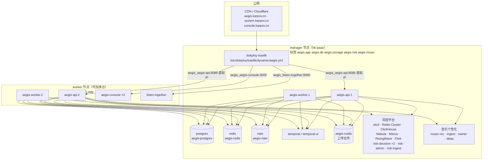

# 分布式部署：Docker Swarm 统一栈与 aegisctl

> 2026-11-17 起草。取代 HK Dokploy 上分散的 aegis-api / aegis-console / listen-together 应用与 aegis-infra / aegis-risk / aegis-music 三个 compose 项目。

## 1. 为什么换

现网的问题：同一套系统分在 3 个 Dokploy 应用、3 个 compose 项目里；环境变量要在 Dokploy、运行中的服务、本机备份三处手工对齐；建目录、改属主、生成密码、建库、补触发部署 webhook 都靠人；只能单机。

统一栈之后：

- 一份栈文件 `deploy/swarm/aegis-stack.yml`，`docker stack deploy` 一次管全部组件；
- 一份配置 `/etc/aegis/cluster.env`（manager 上，唯一真源），所有密钥与参数都在这里；
- 一个命令行 `aegisctl`（`cmd/aegisctl`），在运维者本机经 ssh 操作：初始化、加机器、改配置、构建、发布（先迁移后滚动、失败自动回滚）、看状态、备份、体检；
- aegis-api 与 aegis-worker 拆开、各自多副本，跨节点分布；有状态组件用节点标签固定位置。

## 2. 架构



网络：

| 网络 | 谁在上面 | 说明 |
|---|---|---|
| `dokploy-network` | Traefik、aegis-api、aegis-console、listen-together、temporal-ui、aegis-rustfs | Dokploy 的 overlay，Traefik 只能经它找到后端 |
| `aegis-internal` | 栈里全部服务 | `aegisctl init` 建的私有 overlay（attachable，可选 IPsec 加密）。数据库、缓存、消息、风控、音乐只在这张网上，别名与现网相同（`aegis-postgres`、`aegis-redis`、`aegis-nats`、`aegis-temporal`、`risk-*`、`music-rec`），连接串不用改 |

节点标签与调度：

| 标签 | 固定在上面的服务 | 数据 | 可扩 |
|---|---|---|---|
| `aegis.app=true` | aegis-api、aegis-worker、aegis-console、listen-together、aegis-migrate | 每个副本一个命名卷 `aegis-api-data-<槽位>` / `aegis-worker-data-<槽位>`（不跨节点、不要求持久） | 是，`aegisctl scale` |
| `aegis.db=true` | postgres、redis、nats、temporal、temporal-ui | `/srv/aegis/postgres`、`/srv/aegis/redis`、`/srv/aegis/nats/*` | 否，单副本 |
| `aegis.storage=true` | aegis-rustfs | `/srv/aegis/rustfs` | 否 |
| `aegis.risk=true` | 风控平台 19 个服务 | `/srv/aegis/risk/*`（与现网一致） | 否（risk-decision 是两个固定实例） |
| `aegis.music=true` | music-rec、music-ingest、music-trainer、music-deep | 无本地数据 | 否 |

有状态标签同一时刻只打在一个节点上：数据是该节点的绑定目录，打到第二台等于让任务漂到一份空数据上。`aegisctl doctor` 会检查。

主服务的副本之间靠 Postgres 租约选主、NATS 广播缓存失效（Go 侧已做），编排不用管。`/app/data` 只放每个副本自己的东西（崩溃日志、搜索索引、风控暂存、mihomo），bbolt 与 Bleve 都带文件锁，所以每个副本槽位一个卷。**上传文件不能放本地**：多节点时必须用对象存储（第 11 节）。

## 3. 文件

| 文件 | 作用 |
|---|---|
| `deploy/swarm/aegis-stack.yml` | 栈文件（compose v3.9 的 Swarm 写法） |
| `deploy/swarm/cluster.env.example` | cluster.env 模板：全部变量与注释，`#@ secret` 等标注告诉 aegisctl 哪些要自动生成 |
| `deploy/swarm/traefik/aegis.yml.tmpl` | Traefik 动态配置模板（只写 routers / services） |
| `cmd/aegisctl/` | 命令行 |
| `.github/workflows/images.yml` | push main 时按路径构建改动的镜像，推到 `ghcr.io/michongs/<镜像>:sha-<短哈希>` 与 `:main` |
| manager：`/etc/aegis/cluster.env` | 唯一真源（600），改动前自动备份到 `/etc/aegis/env-backups/` |
| manager：`/etc/aegis/deploy-history.jsonl` | 部署历史（时间、标签、操作人、结果） |
| manager：`/srv/aegis/src` | `aegisctl build` 用的仓库克隆 |
| manager：`/srv/aegis/backups/<日期-时间>/` | `aegisctl backup` 的产物 |
| 本机：`~/.config/aegisctl/config.json` | manager 主机名、节点与 ssh 目标的对应、是否 sudo |
| 本机：`~/.config/aegisctl/cluster.env` | `aegisctl config pull` 的备份（600） |

镜像：`aegis-server`（api / worker / migrate 共用，`AEGIS_ROLE` 选角色）、`aegis-console`、`aegis-listen-together`、`aegis-risk`、`aegis-risk-cep`、`aegis-music`、`aegis-music-deep`。标签格式 `sha-<7 位短哈希>`，CI 与 `aegisctl build` 相同。

## 4. 安装 aegisctl

```bash
cd ~/…/aegis
go build -o ~/.local/bin/aegisctl ./cmd/aegisctl
aegisctl help
```

在仓库目录里运行（它从当前目录向上找 `deploy/swarm/aegis-stack.yml`），或者在 `~/.config/aegisctl/config.json` 里写 `repoDir`：

```json
{
  "manager": "hk-paas",
  "repoDir": "/run/media/chuanyi/开发/NodejsProjects/userSystem/aegis",
  "sudo": false
}
```

`manager` 是 `~/.ssh/config` 里的主机名；ssh 用户不是 root 时设 `"sudo": true`（远端用 `sudo -n`，要配免密 sudo）。aegisctl 只用 ssh，不在服务器上装任何东西。

保密约定：所有输出里敏感值都打码（长度加 sha256 前 8 位）；密钥只经 ssh 的标准输入传给远端 bash，不出现在任何进程参数里；`config get --reveal` 只在交互终端里可用。

## 5. 从零建集群

1. 准备一台装好 Docker Engine 的 Linux（建议 8 核 32 GB 起，风控平台自己要约 23 GiB 上限，见 `docs/risk-deploy-hk.md` 第 3 节），本机能 `ssh <它>`。装 chrony 同步时钟。
2. 初始化：
   ```bash
   aegisctl --manager <主机> init            # 先加 --dry-run 看一遍
   ```
   做的事：没加入 Swarm 就 `docker swarm init`（多网卡时加 `--advertise-addr 内网IP`）；建 `/etc/aegis`（700）；按模板生成 `/etc/aegis/cluster.env`（600），所有密码类变量生成字母数字随机值；建 `/srv/aegis/...` 全部数据目录并设属主（Milvus 999、ClickHouse 101、Flink 9999、风控暂存 10001）；首次生成 `nats-server.conf`；建 `aegis-internal` 与 `dokploy-network`（没有 Dokploy 时）两个 overlay；给这台 manager 打上全部标签。可重复执行：已有的键、目录、网络、标签都不动，只补缺。
3. 改域名等：`aegisctl config edit`（`AEGIS_API_DOMAINS`、`AEGIS_CONSOLE_DOMAINS`、`API_BASE_URL`、`CONSOLE_BASE_URL`、`TRUSTED_PROXIES` 等），然后 `aegisctl config pull` 备份到本机。
4. 没有 Dokploy 的新集群要自己跑一个 Traefik（file provider 指向 `AEGIS_TRAEFIK_DYNAMIC_FILE` 所在目录、接在 `dokploy-network` 上），或把 `AEGIS_TRAEFIK_DYNAMIC_FILE` 改到现有反代的动态配置目录。
5. 镜像：`docker login ghcr.io`（在 manager 上，PAT 需要 `read:packages`；用 `aegisctl build` 推镜像还要 `write:packages`）。然后 `aegisctl build` 或等 CI。
6. `aegisctl doctor`，全绿后 `aegisctl deploy --tag sha-xxxxxxx`。

## 6. 加机器

```bash
aegisctl node join <新机器的 ssh 主机>                         # 默认 worker，标签 aegis.app=true
aegisctl node join db-2 --labels aegis.app=false               # 只当备用、不跑应用
aegisctl node join mgr-2 --role manager --advertise-addr 10.0.0.12
aegisctl node ls
```

join 会：从 manager 取加入令牌（令牌经标准输入传过去，不进进程参数）；检查新机器上的 Docker（没有就提示安装命令，不会替你 `curl | sh`）；`docker swarm join`；打标签；把「节点主机名 → ssh 目标」记进本机 config.json（exec、backup、doctor 跨节点时用）。新增有状态标签时还会在那台机器上建数据目录。

节点之间要放行 2377/tcp（manager）、7946/tcp+udp、4789/udp；`AEGIS_INTERNAL_ENCRYPTED=true` 时还要放行 ESP（IP 协议 50）。跨机房建议打开加密。

manager 个数用 1 或 3（2 个比 1 个更脆弱：任一失联即失去多数）。

加完 worker 之后多副本就会自动分散（`placement.preferences: spread node.id`），想要更多副本：`aegisctl scale aegis-api=4 aegis-worker=3`。

其他节点操作：

```bash
aegisctl node label hk-2 aegis.app=true aegis.music=true   # k- 删除标签
aegisctl node drain hk-2       # 维护前把任务迁走；aegisctl node active hk-2 恢复
aegisctl node rm hk-2          # 排空 → 在那台机器上 swarm leave → 从集群删除；失联的机器加 --force
```

## 7. 日常发布

### 7.1 构建镜像

两种来源，标签都是 `sha-<7 位短哈希>`：

- **CI**（推荐）：push 到 main，`.github/workflows/images.yml` 只构建改动涉及的镜像。手动触发可指定镜像。
- **manager 上构建**：`aegisctl build [镜像 ...] [--ref 提交]`。在 `/srv/aegis/src` 检出提交（要先推到 GitHub），`docker buildx build --push`。镜像名可写简称：`server`、`console`、`lt`、`risk`、`cep`、`music`、`deep`。

**镜像仓库（2026-11-17 现状）**：GHCR 上的包默认私有，manager 没有登录 GHCR，所以现网用的是 manager 本机的仓库 `127.0.0.1:5000`（容器 `aegis-registry`，`--restart always`，数据在 `/srv/aegis/registry`，只监听回环地址），`cluster.env` 里 `AEGIS_REGISTRY=127.0.0.1:5000`。日常发布在 manager 上 `aegisctl build` 推到这里。单节点够用；**加第二台机器之前**要换成各节点都能拉的仓库：把 GHCR 上的 7 个包设为公开（或在每台机器上 `docker login ghcr.io`），再 `aegisctl config set AEGIS_REGISTRY=ghcr.io/michongs`。

第一次部署时栈还不存在，没有新标签的镜像用 `cluster.env` 里钉住的 `*_TAG`（例如 `AEGIS_RISK_TAG`）；之后沿用栈里正在跑的版本。

### 7.2 发布

```bash
aegisctl deploy --dry-run                  # 看计划：每个镜像用哪个标签、分几段
aegisctl deploy                            # 标签默认取本机仓库 HEAD
aegisctl deploy --tag sha-1a2b3c4
aegisctl deploy --only app                 # 只发主服务（迁移 + api + worker）
aegisctl deploy --only aegis-console,listen-together
```

`--only` 可写服务名或组名：`app`（aegis-migrate、aegis-api、aegis-worker）、`web`（控制台、一起听）、`infra`、`risk`、`music`。

deploy 的过程：

1. 读 manager 上的 cluster.env 与本机仓库的栈文件，在本机先渲染一遍：缺变量在动手前就报出来。
2. 解析镜像标签：选中的服务用到的镜像在仓库里有这个标签就用；没有（例如 CI 没构建它，因为它没改动）就沿用现网正在跑的版本，并提示；现网也没有就报错。
3. 加锁（`/etc/aegis/deploy.lock`，防止两个人同时发布；异常退出留下的锁用 `--force-unlock` 清）。
4. **第一段**：除主服务外选中的服务 `docker stack deploy --prune=false`（基础设施、风控、音乐、控制台、一起听）。
5. **第二段**：等 Postgres 就绪，更新一次性任务 aegis-migrate（新镜像，`aegis-server migrate`，带 advisory lock，可重复执行）并等它跑完。镜像没变时 Swarm 不会重跑，aegisctl 会 `--force` 重跑。**失败就停在这里，api / worker 不更新**，并打印迁移日志。
6. **第三段**：aegis-api、aegis-worker 按副本槽位逐个滚动：先停旧任务（收到 SIGTERM 后 `/readyz` 先回 503、等 `SHUTDOWN_DRAIN_DELAY` 再关监听），再在同一槽位的卷上起新任务，`/readyz` 健康后才轮到下一个槽位。每个槽位的卷里有带文件锁的暂存与索引，新旧任务不能同时打开，所以这两个服务用先停后起（stop-first）；其余副本始终在接流量，因此**副本数至少为 2**。新副本若发现库里缺迁移会一直报未就绪，滚动随即停住并回滚。
7. 等全部选中的服务收敛，逐个打印进度。某个服务失败：Swarm 按 `failure_action: rollback` 自动回滚；没有自动回滚的（超时、暂停）aegisctl 执行 `docker service rollback`，并打印该服务的任务错误与最近日志。
8. 成功后渲染 Traefik 模板写到 `/etc/dokploy/traefik/dynamic/aegis.yml`（旧文件先备份到 `/etc/aegis/traefik-backups/`，内容没变就不写）。
9. 写一条部署历史：`aegisctl history`。

停机影响：主服务、控制台、一起听是滚动更新，无中断（CDN 侧可能看到个别连接重置，长连接的一起听会重连）。有状态服务（Postgres、Redis、NATS、Temporal、风控组件）只有镜像或配置变了才会重启，重启是先停后起，期间依赖它的功能短暂不可用（Postgres 约几秒到几十秒）。所以基础设施的版本升级要单独安排：`aegisctl deploy --only infra`。

### 7.3 配置

```bash
aegisctl config get                         # 全部键，敏感值打码
aegisctl config get TRUSTED_PROXIES API_BASE_URL
aegisctl config set POSTGRES_MAX_CONNS=30 AEGIS_API_REPLICAS=3
aegisctl config set SECURITY_PASSKEY_RP_ORIGINS -   # 从标准输入读（不回显、不进 shell 历史）
aegisctl config unset LEGACY_MYSQL_DSN
aegisctl config edit                        # $EDITOR 编辑，显示差异（只有指纹），确认后上传
aegisctl config pull                        # 备份到本机 ~/.config/aegisctl/cluster.env
aegisctl config diff                        # 本机备份与线上的差异：键名 + sha256 前 8 位
aegisctl config push                        # 用本机备份覆盖线上（先显示差异）
```

改完都要 `aegisctl deploy` 才生效（env_file 在部署时读进服务定义）。只改了主服务的变量就 `aegisctl deploy --only app`。

值不加引号（与 docker 的 env_file 一致，引号会原样进值里，`doctor` 会提醒）。拼进 DSN 的密码只用字母数字。新增 CDN 节点时 `TRUSTED_PROXIES` 与 Traefik 的 `forwardedHeaders.trustedIPs`（`/etc/dokploy/traefik/traefik.yml`）两处都要加，后者不在 aegisctl 管理范围内。

## 8. 扩缩容

```bash
aegisctl scale aegis-api=4 aegis-worker=3
aegisctl scale aegis-console=1 --no-persist     # 只改运行中的，下次 deploy 恢复
```

可扩缩的只有 aegis-api、aegis-worker、aegis-console、listen-together；默认同时写回 cluster.env 的 `AEGIS_*_REPLICAS`，下次 deploy 保持。aegis-api、aegis-worker 的副本数不要低于 2：它们按槽位先停后起，只有 1 个副本时发布期间会短暂中断。`AEGIS_API_MAX_PER_NODE` 限制单节点上的副本数，单节点集群要不小于副本数。

扩副本前算一下 Postgres 连接：`(api + worker + 2) × POSTGRES_MAX_CONNS`，再加风控、音乐、Temporal 约 40 条，要小于 `max_connections`（tuning.sql 是 200）。`aegisctl doctor` 会按线上的 max_connections 算。

## 9. 看状态

```bash
aegisctl status                 # 一屏总览
aegisctl status --watch         # 每 5 秒刷新（--interval 调整）
aegisctl logs aegis-api -f --since 10m
aegisctl logs aegis-migrate --tail 500
aegisctl exec aegis-api -- sh
aegisctl exec postgres -- sh -c 'psql -U "$POSTGRES_USER" -d postgres -c "select 1"'
aegisctl doctor
```

status 显示：节点（在线、可调度、标签、各节点上的 aegis 任务数）；每个服务的 运行/期望 副本、镜像标签、最近一次更新状态（完成 / 更新中 / 已回滚 / 暂停）与各节点分布；以及在 aegis-internal 上起一个临时 `curlimages/curl` 容器，逐个探 api（`tasks.aegis-api:8088/readyz`）与 worker（`tasks.aegis-worker:8089/readyz`）副本。绿：齐全；黄：部分或更新中；红：没有运行的副本或探测失败。输出不是终端、设了 `NO_COLOR` 或 `--no-color` 时不着色。

exec 会找到一个运行中的任务所在的节点，ssh 过去 `docker exec`。

doctor 检查：Swarm 与 manager 数、节点状态、标签齐不齐（有状态标签是否唯一）、cluster.env 必填键与示例值、栈文件能否完整渲染、网络、各节点磁盘（80% 黄、90% 红）、时钟偏差（2 秒黄、30 秒红：客户端请求时间戳校验会失败）、有状态节点上的数据目录、manager 是否登录镜像仓库、现网镜像标签可否拉取（节点重建任务时要拉）、Traefik 动态配置与容器、其他动态配置文件里是否还有同域名的旧路由、Postgres 连接预算。

## 10. 回滚

| 情况 | 做法 | 影响 |
|---|---|---|
| 发布时某服务没起来 | 不用动：Swarm 自动回滚，aegisctl 补回滚没自动回滚的 | 该服务保持旧版本 |
| 迁移失败 | 不用动：api / worker 没有更新。修好后重新 deploy | 无 |
| 发布成功后发现问题 | `aegisctl rollback aegis-api aegis-worker`（或 `rollback app`、`rollback all`） | 滚动回到上一版，无中断 |
| 要回到更早的版本 | `aegisctl history` 找标签，`aegisctl deploy --tag sha-旧` | 同正常发布 |
| 迁移不向后兼容 | 先 `aegisctl backup`；回滚代码不会撤销迁移，需要对应的回退迁移 | 视迁移而定 |

`rollback` 只改运行中的服务（Swarm 保存的上一个版本），下次 deploy 按指定标签重新发布。

## 11. 备份与恢复

```bash
aegisctl backup                     # 落 manager 的 /srv/aegis/backups/<日期-时间>/，保留 AEGIS_BACKUP_KEEP 份（默认 7）
aegisctl backup --to ~/aegis-backups --keep 14
```

内容：`postgres.sql.gz`（`pg_dumpall --clean --if-exists`，全部库：主库、aegis_risk、aegis_music、temporal）、`redis-dump.rdb.gz`（先 BGSAVE 再拷 RDB）、`nats-server.conf`、`cluster.env`，加 `SHA256SUMS`。Postgres 或 Redis 不在 manager 上时经本机中转流到 manager。备份目录 700、文件 600。清理只删名字是「8 位日期-6 位时间」的目录。

不在备份里：JetStream 数据（事件流，可丢）、风控的 ClickHouse / Nebula / Milvus / RisingWave（量大，需要时停服务后直接打包 `/srv/aegis/risk`）、RustFS（对象存储本身另做复制，或定期用 rclone 同步到另一处 S3）。定时备份：在本机 crontab 加 `aegisctl backup --to ...`，或在 manager 上用 systemd timer 调本机下发的脚本。

恢复 Postgres（停机操作）：

```bash
aegisctl down --keep postgres --yes                 # 只留数据库
ssh hk-paas 'gunzip -c /srv/aegis/backups/<时间>/postgres.sql.gz | docker exec -i $(docker ps -q -f label=com.docker.swarm.service.name=aegis_postgres) psql -U <AEGIS_PG_USER> -d postgres'
aegisctl deploy                                     # 全部拉起
```

恢复 Redis：`aegisctl down --keep redis`，把 RDB 解压成 `AEGIS_REDIS_DIR/dump.rdb`（Redis 停着时），再 deploy。

## 12. 故障处理

**一台 aegis.app 节点宕机**：Swarm 在约十几秒内判定节点 Down，把上面的 api / worker / 控制台 / 一起听任务调度到其他 `aegis.app` 节点（只要还有节点有余量）。服务的虚拟 IP 自动摘掉坏掉的副本，Traefik 不用改。只有一台 aegis.app 节点时，在它恢复前这些服务不可用。新副本用的是新节点上的空命名卷：搜索索引会重建，暂存里没送出的事件留在旧节点的卷里，节点恢复后由那个槽位的新任务接着送（同槽位同名卷）。

**有状态节点（aegis.db / aegis.risk / aegis.storage）宕机**：固定在上面的服务停住，不会漂移（数据在那台机器上）。影响：aegis.db 宕机 = 主服务整体不可用；aegis.risk 宕机 = 风控按场景失败策略放行（业务不中断，风控变弱）；aegis.storage 宕机 = 上传与读取文件失败；aegis.music 宕机 = 推荐回退。机器恢复后任务自动起来。机器彻底坏了：从备份在新机器上恢复，见下面「有状态服务换节点」。

**manager 宕机**：单 manager 时，已经在跑的容器照常工作，但不能调度、不能发布；Traefik（Dokploy 的）也在 manager 上，所以入口一起断。这是当前拓扑的单点。要消除控制面的单点就再加两台 manager（`node join --role manager`），入口的单点要另做（多台机器各跑 Traefik + DNS 或负载均衡）。

**风控 Redis Cluster 报 CLUSTERDOWN**：三个节点都重启过、地址全变了时会出现。`ssh hk-paas docker service update --force aegis_risk-redis-init` 重新握手（全量 deploy 时 aegisctl 会自动做）。

**某服务一直起不来**：`aegisctl status` 看副本，`aegisctl logs <服务>`，`ssh hk-paas docker service ps --no-trunc aegis_<服务>` 看调度错误（常见：标签没打、绑定目录不存在、`max_replicas_per_node` 太小、内存不够）。

**有状态服务换节点**（例如把数据库挪到独立机器，停机操作）：

1. `aegisctl backup`；
2. `ssh hk-paas docker service scale aegis_postgres=0 aegis_redis=0 aegis_nats=0 aegis_temporal=0`（主服务会报错，属于停机窗口）；
3. 把 `/srv/aegis/postgres`、`redis`、`nats` 用 `rsync -aHAX --numeric-ids` 拷到新机器同一路径；
4. `aegisctl node label <新机器> aegis.db=true`，`aegisctl node label <旧机器> aegis.db-`；
5. `aegisctl deploy --only infra`，再 `aegisctl deploy --only app`；
6. 确认无误后再删旧机器上的数据。

## 13. 从现网 Dokploy 切到统一栈

原则：每一步都能退回；数据目录原地复用（栈文件里的绑定路径与现网相同，`init --import-dokploy` 按现网容器的实际挂载点改写）；Dokploy 里的项目只停不删。

建议先把包含 Go 侧改动（`AEGIS_ROLE`、`aegis-server migrate`、`MIGRATE_ON_BOOT`）的那个提交照常经 Dokploy 发上去跑一两天（默认 `AEGIS_ROLE=all`、启动时迁移，行为与现在相同），再用**同一个提交**切换。这样切换与回滚两边是同一版本、同一套表结构，回滚最干净。

### 第 0 步：准备（零影响）

1. 本机装好 aegisctl（第 4 节），config.json 里 `manager: hk-paas`。
2. Dokploy 里关掉 aegis-api、aegis-console、listen-together 的自动部署（Auto Deploy）。否则切换后一次 push 会把旧应用重新拉起来，和新栈抢同一份数据。
3. 确认没有别的 Dokploy 应用经 `dokploy-network` 直接连 `aegis-postgres` / `aegis-redis` / `aegis-nats`（切换后它们只在 aegis-internal 上）：
   ```bash
   ssh hk-paas 'for s in $(docker service ls --format "{{.Name}}"); do docker service inspect --format "{{json .Spec.TaskTemplate.ContainerSpec.Env}}" "$s" | grep -qE "aegis-(postgres|redis|nats)" && echo "服务 $s"; done; for c in $(docker ps --format "{{.Names}}"); do docker inspect --format "{{json .Config.Env}}" "$c" | grep -qE "aegis-(postgres|redis|nats)" && echo "容器 $c"; done'
   ```
   （只打印名字，不打印变量值。）除了 aegis-api、listen-together、风控与音乐的容器之外还有别的，就把那个应用的服务也接到 aegis-internal（`docker service update --network-add aegis-internal <服务>`），或改走 HTTP 接口。

### 第 1 步：初始化与导入（零影响）

```bash
aegisctl init --import-dokploy --dry-run
aegisctl init --import-dokploy
```

导入读的是**正在运行**的服务与容器（`docker inspect`），不是 Dokploy 库里加密的环境变量：运行中的才是真正生效的值。取到的内容：

- 现网 aegis-api 的全部环境变量（栈文件会覆盖的连接项除外），模板里没有的追加在文件末尾；从 `POSTGRES_DSN` 拆出 `AEGIS_PG_USER / PASSWORD / DB / DSN_PARAMS`，从 `NATS_URL` 拆出 NATS 账号；
- aegis-infra 里 Postgres、Redis、NATS、Temporal 容器的数据挂载点（`AEGIS_PG_DIR` 等）、镜像版本、Redis 的 `--requirepass` 与其余参数、Temporal 的数据库账号；
- aegis-risk 里 risk-admin 的密钥（Redis、ClickHouse、Nebula、对象存储、内部令牌、代理网段；对象存储的那一对沿用为 RustFS 的凭据）与 `/srv/aegis/risk`；aegis-music 的内部令牌；
- 一起听的内部令牌与 `LT_*` 调参项。

逐条看输出里的「注意」：例如数据目录不是绑定挂载、NATS 的 store_dir 与新挂载点不一致、风控用的 Postgres 账号与主库账号不同（统一栈改用主库账号，确认它对 aegis_risk 有权限）、控制台设了 `NEXT_PUBLIC_*`（console.Dockerfile 目前不接收）。然后：

```bash
aegisctl config get            # 核对：AEGIS_PG_DIR 等路径、域名、TRUSTED_PROXIES
aegisctl config edit           # 补 AEGIS_API_DOMAINS 等
aegisctl config pull           # 本机备份
```

init 这一步只建了 `/etc/aegis`、缺失的目录、aegis-internal 网络，给 manager 打了标签，对运行中的 Dokploy 服务没有任何影响。`/srv/aegis` 下已有的数据目录不改属主。

### 第 2 步：镜像（零影响）

push main 由 CI 构建，或 `aegisctl build`（在 manager 上构建，约 10 分钟，构建期间占 CPU）。manager 上 `docker login ghcr.io`。`aegisctl doctor` 看「镜像仓库」「cluster.env」「栈文件」全绿（此时「栈还没有部署」是黄的，正常）。

### 第 3 步：先迁上传文件（零停机）

上传文件现在在 `/srv/aegis/aegis-api/data/storage`（本地存储池）。切换后每个副本是自己的命名卷，看不到这些文件，所以**切换前**先迁到对象存储：

```bash
aegisctl deploy --only aegis-rustfs --tag sha-xxxxxxx
```

aegis-rustfs 同时接在 dokploy-network 上，现网的 Dokploy aegis-api 就能经 `aegis-rustfs:9000` 访问它（栈里还没有 aegis-api 时，deploy 不写 Traefik 路由）。然后在控制台「存储中心」：

1. 新建 RustFS 存储池：endpoint `aegis-rustfs:9000`、不用 SSL、桶 `aegis-uploads`、打开「自动创建存储桶」，access key / secret key 用 `AEGIS_RUSTFS_ACCESS_KEY` / `AEGIS_RUSTFS_SECRET_KEY`（`aegisctl config get --reveal AEGIS_RUSTFS_SECRET_KEY`，或在 RustFS 控制台另建只读写这个桶的用户）；
2. 用「存储迁移」把本地存储池的文件迁到新池，等迁移完成、核对数量；
3. 把新池设为各应用的默认存储（头像 `AVATAR_STORAGE_CONFIG` 若指定了本地池也要改）。

如果存储池配置要求客户端直连对象存储下载（预签名地址），给 RustFS 配公网域名：`aegisctl config set AEGIS_RUSTFS_DOMAINS=files.karpov.cn`，切换后的 deploy 会生成路由。经 Aegis 代理下载的不需要。

这一步现网照常服务。

### 第 4 步：切换（停机，预计 5 到 15 分钟）

停机范围：API、控制台、一起听全部不可用；客户端看到 502 / 连接失败，CDN 可能回源错误页。选低峰时段。

1. 切换前备份（Dokploy 的 Postgres 还在跑）：
   ```bash
   ssh hk-paas 'c=$(for id in $(docker ps -q); do docker inspect --format "{{.Id}} {{json .NetworkSettings.Networks}}" "$id"; done | grep "\"aegis-postgres\"" | cut -d" " -f1 | head -n1); mkdir -p /srv/aegis/backups && docker exec "$c" sh -c "pg_dumpall -U \"\$POSTGRES_USER\"" | gzip > /srv/aegis/backups/pre-cutover.sql.gz && ls -lh /srv/aegis/backups/pre-cutover.sql.gz'
   ```
   （按网络别名 aegis-postgres 找 Dokploy 的 Postgres 容器。）
2. 在 Dokploy 里**停止**（Stop，不要 Delete）：先应用 aegis-api、aegis-console、listen-together（停止写入），再 compose 项目 aegis-music、aegis-risk，最后 aegis-infra。
3. 确认旧容器都停了、没有进程占着数据目录：
   ```bash
   ssh hk-paas 'docker ps --format "{{.Names}}" | grep -E "aegis|risk|music|listen" | grep -v "^aegis_"; ls /srv/aegis/postgres/postmaster.pid 2>/dev/null'
   ```
   两行都应当没有输出（路径以 `AEGIS_PG_DIR` 为准）。
4. 风控对象存储从 MinIO 搬到 RustFS（现网约 50 MB，一两分钟）。Milvus 的段文件就在这里，必须在 Milvus 起来**之前**搬完：
   ```bash
   aegisctl deploy --only risk-rustfs --tag sha-xxxxxxx
   aegisctl objstore migrate --yes
   ```
   它在风控节点上临时起一个 MinIO 读 `/srv/aegis/risk/minio`，用 rclone 把全部存储桶（Milvus 的 `a-bucket`、模型文件 `aegis-risk`）复制进 risk-rustfs，再逐对象按校验和核对，最后删掉临时容器。旧目录里的对象不会被改动（临时 MinIO 只写它自己的 `.minio.sys` 元数据），回滚时旧 MinIO 原样可用。还有容器挂着旧目录、或 risk-milvus / risk-admin 在运行时会拒绝执行；中途失败直接再跑一次（已复制的对象跳过）。只想核对用 `aegisctl objstore check`。
5. 部署：
   ```bash
   aegisctl deploy --tag sha-xxxxxxx
   ```
   第一段拉起 Postgres、Redis、NATS、Temporal（原数据目录，约 30 秒）与风控、音乐（Milvus、RisingWave 要 1 到 2 分钟）、控制台、一起听；第二段迁移（版本与现网相同时没有新迁移，几秒）；第三段 api / worker；收敛后写 Traefik 路由（优先级 1000，高于 Dokploy 给旧应用生成的同域名路由，Traefik 约 2 秒内生效）。
6. 旧的本地数据（可选）：搜索索引会自动重建；如果担心旧进程的风控暂存里有没送出的事件，把旧目录拷进 api 第 1 个槽位的卷（用 aegis-server 镜像本身，按用户名改属主）：
   ```bash
   ssh hk-paas 'docker run --rm --user 0 --entrypoint sh -v /srv/aegis/aegis-api/data:/from:ro -v aegis-api-data-1:/app/data ghcr.io/michongs/aegis-server:sha-xxxxxxx -c "cp -an /from/. /app/data/ && chown -R aegis:aegis /app/data"'
   ```
   然后 `ssh hk-paas docker service update --force aegis_aegis-api` 让它重新读取。

### 第 5 步：验收

- `aegisctl status`：全部服务副本齐全，api / worker 探测全部就绪；`aegisctl doctor` 全绿（「其他文件里也有同域名路由」是黄的，正常）。
- `curl -sI https://aegis.karpov.cn/healthz`、`https://system.karpov.cn/healthz` 回 200；`https://console.karpov.cn/` 能登录；控制台各页（用户、风控决策流水、音乐、一起听）有数据。
- 客户端 IP 正确：`aegisctl logs aegis-api --since 5m | grep '"ip"'`，不应出现 10.0.x.x 或 CDN 节点地址（TRUSTED_PROXIES 已导入）。
- 风控：控制台风控总览 9 个组件 ok；主服务日志里没有「风控评估失败，按放行处理」。
- 后台任务：worker 日志里有定时任务在跑（自动签到、排行榜结算），且只在一个副本上执行（租约选主）。
- 上传：上传一张头像，确认落在 aegis-rustfs。
- 风控向量：控制台相似设备能查出结果（Milvus 从 RustFS 载入了段文件）；`aegisctl logs risk-milvus --since 10m` 里没有 NoSuchKey。

### 第 6 步：回滚（停机，约 5 分钟）

任何一步验收不过：

```bash
aegisctl traefik disable            # 移走新路由，Dokploy 旧路由重新生效（旧应用还停着，此时仍是 502）
aegisctl down --keep aegis-rustfs --yes   # 删除栈里的服务，等容器退出；数据目录与命名卷保留，aegis-rustfs 留着给旧应用用
```

然后在 Dokploy 里按 aegis-infra → aegis-risk → aegis-music → aegis-api、aegis-console、listen-together 的顺序启动（应用用 Deploy / Redeploy）。数据是同一份目录，新栈期间写入的数据都在；上传文件在 aegis-rustfs 里，旧应用经 dokploy-network 照样访问；风控的旧 MinIO 目录没被改过，Dokploy 的 aegis-risk 照旧用它（新栈期间写进 risk-rustfs 的新向量不会回到旧 MinIO，回滚后由风控事件重新写入）。要连 aegis-rustfs 也撤掉：先在存储中心把默认存储切回本地池并反向迁移，再 `aegisctl down --yes`。

### 第 7 步：收尾（稳定运行一周后）

- Dokploy 里把旧应用的域名删掉（消除 doctor 的同域名提醒），项目可以保留不动或删除；
- 确认上传文件已全部在对象存储后，再删 `/srv/aegis/aegis-api/data`；
- `aegisctl objstore check` 再核对一次风控对象存储，然后可以删掉旧目录 `/srv/aegis/risk/minio`（删了就不能再回滚到 Dokploy 的 aegis-risk）；
- 本机旧的环境变量备份（`~/Documents/zeabur-migration/env/aegis/*.env`）不再是配置来源，以 `aegisctl config pull` 的备份为准。

## 14. 多节点之后的对象存储

单节点时也建议用 aegis-rustfs（第 13 节第 3 步）。加了第二台 aegis.app 节点之后**必须**用：任何一个副本收到的上传，其他节点上的副本都要能读到，本地存储池做不到。

aegis-rustfs 本身是单节点单盘（固定在 `aegis.storage` 节点上），它坏了上传不可用。要更高可用：换成云厂商的 S3 兼容存储（存储中心改 endpoint 后再做一次存储迁移），或部署多节点 RustFS（`RUSTFS_VOLUMES` 列出各节点的盘，纠删码），这不在统一栈里。

### 为什么是 RustFS

统一栈的两个对象存储（主服务 aegis-rustfs、风控 risk-rustfs）都是 RustFS 1.0.6（Apache-2.0，S3 兼容）。MinIO 社区版已停止接受社区改动，长期维护没有保障，所以换掉。兼容性在本机实测过：存储中心用的 minio-go 客户端（建桶、分片上传 70 MiB、预签名上传下载、列举、删除）、风控模型文件用的 aws-sdk-go-v2，以及 Milvus 3.0.5（自定义密钥、写段文件、刷盘、重启后从 RustFS 重新载入并检索）。存储中心里已有的 MinIO 类型存储池照常可用，新建的选 RustFS。

## 15. 已知限制

- Swarm 不支持 `security_opt`：Milvus 去掉了 `seccomp:unconfined`，若 Milvus 启动报系统调用被拒，需要在该节点的 daemon.json 放宽 seccomp，或把 Milvus 留在 compose 里单独跑。
- 官方 `nats:2` 镜像没有 shell，栈里没给 NATS 配健康检查；doctor 与 status 通过依赖它的服务判断。
- 统一栈没有编排 Hydra（对外 OAuth2）与 rdkit-captcha；现网用到时先保持原样，`HYDRA_ADMIN_URL`、`RDKIT_CAPTCHA_URL` 指向它们的地址（需要接到 aegis-internal 或 dokploy-network）。
- 控制台的后端地址是构建期烘进去的（`AEGIS_CONSOLE_API_BACKEND`，默认 `http://aegis_aegis-api:8088`）；`console.Dockerfile` 不接收 `NEXT_PUBLIC_*`。
- Traefik 的 `forwardedHeaders.trustedIPs` 在 Dokploy 的静态配置里，aegisctl 不改它；新增 CDN 节点要手工加并 `docker restart dokploy-traefik`。
- `aegisctl rollback` 只回滚运行中的服务定义，不回滚 cluster.env；配置改错了用 `/etc/aegis/env-backups/` 里的备份或本机备份 `config push`。
